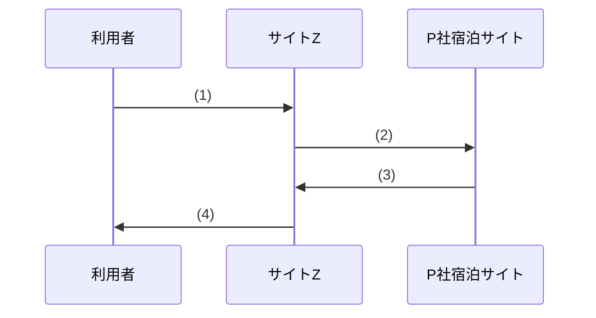
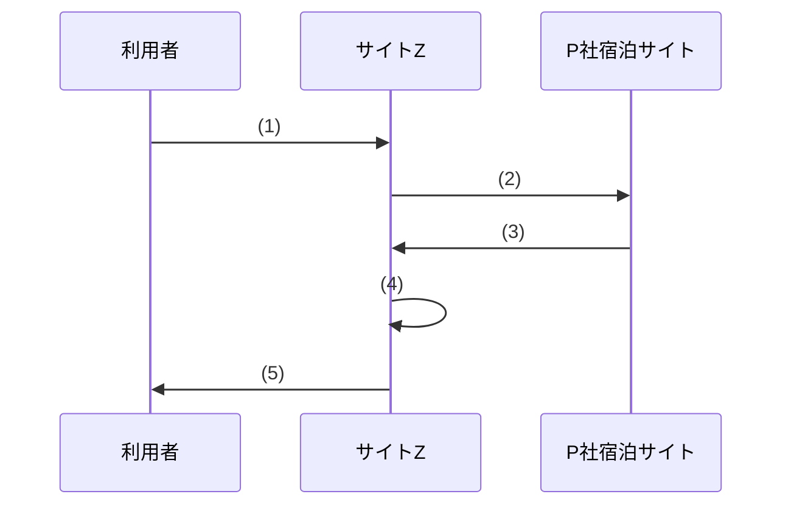
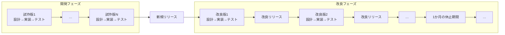

## 問1（午後II） Webサイトのセキュリティに関する次の記述を読んで、設問1〜6に答えよ。

（令和4年度春期 午後II 問1）

A社は、従業員1,500名の中堅システム開発会社である。A社では、セキュリティ品質の高いWebサイトを開発するために、表1に示すWebセキュリティ管理基準を定めて運用している。

**表1 Webセキュリティ管理基準（抜粋）**

| 項番 | 管理策 | 概要 |
| :--- | :--- | :--- |
| 1 | セキュリティ要件レビュー | ・概要設計、基本設計、詳細設計それぞれの設計レビューにおいて、Webサイトに関するセキュリティ要件をレビューする。 |
| 2 | ツールによるソースコードレビュー | ・Webサイトのリリースまでに実施する。<br>・期間は、3日間くらいが目安である。<br>・開発環境の特性などが原因で実施できない場合、項番3を行う。<br>・ツールが検出した指摘事項について、開発担当者は、脆弱性かどうか、対策が必要かどうかを判断する。<br>・セッション管理の脆弱性は、一部だけが対象である。<br>・認可・アクセス制御の脆弱性は、対象外である。 |
| 3 | プロジェクトメンバによるソースコードレビュー | ・項番2が実施できない場合、Webサイトのリリースまでに実施する。<br>・期間は、10日間くらいが目安である。<br>・A社の指定した既知の脆弱なコードパターンを見つける。<br>・レビューでの指摘事項について、開発担当者は、脆弱性かどうか、対策が必要かどうかを判断する。<br>・セッション管理の脆弱性は、一部だけが対象である。<br>・認可・アクセス制御の脆弱性は、対象外である。 |
| 4 | ツールによる脆弱性診断 | ・Webサイトのリリースまでに実施する。<br>・期間は、3日間くらいが目安である。<br>・Webサイトをテスト環境で稼働させ、ツールでWebサイトに様々なHTTPリクエストを送り、その応答を評価する。<br>・ツールが検出した指摘事項について、開発担当者は、脆弱性かどうか、対策が必要かどうかを判断する。<br>・セッション管理の脆弱性は、一部だけが対象である。<br>・認可・アクセス制御の脆弱性は、対象外である。 |
| 5 | 専門技術者による脆弱性診断 | ・Webサイトのリリースまでに実施する。<br>・期間は、10日間くらいが目安である。<br>・専門会社 ※1 に委託する。<br>・Webサイトをテスト環境で稼働させ、Webサイトに様々なHTTPリクエストを送り、その応答を評価する。<br>・診断による指摘事項について、専門技術者と開発担当者は、対策が必要かどうかを協議して判断する。<br>・セッション管理の脆弱性は、対象である。<br>・認可・アクセス制御の脆弱性は、対象である。 |

*※1 脆弱性診断サービスを提供しているD社に委託している。*

### 〔A社によるB社の子会社化〕

B社は、従業員200名の新興のITサービス会社であり、各種SaaSを提供している。アジャイル開発の能力が高く、機能の追加や性能の改善を頻繁に行っている。B社とA社とは協業関係にあったが、両社の経営陣は、双方の強みを生かせると判断し、A社によるB社の子会社化について合意した。

B社のクラウド環境には、コーポレートサイト（以下、サイトBという）、及びB社が提供中の三つのSaaSそれぞれのWebサイト（以下、サイトX、サイトY、サイトZという）がある。それらの概要を表2に示す。

**表2 B社のWebサイトの概要**

| サイト名及びURL | 概要 | システム構成 |
| :--- | :--- | :--- |
| サイトB<br>`https://www.b-sha.co.jp/` | ・B社に関する情報を発信している。<br>・コンテンツマネジメントシステム（CMS）を導入し、運用している。 | IaaS上のWebサーバで構成されている。 |
| サイトX<br>`https://x.b-sha.co.jp/` | ・会社又は組織向けのコミュニケーションサービスであり、利用する会社間又は組織間で、情報共有やチャットが行える。<br>・利用する会社又は組織は、B社の提携企業の新商品のモニターになると、"キャンペーン応募"をサイトXで行える。 | IaaS上のWebサーバ及びデータベースサーバ ※1（以下、DBサーバという）で構成されている。 |
| サイトY<br>`https://y.b-sha.co.jp/` | ・個人向けのブログサイトであり、利用者が情報を発信できる。<br>・"A社のニューストピック"を表示できる。 | 〃 |
| サイトZ<br>`https://z.b-sha.co.jp/` | ・ソフトウェア開発企業向けのWebサービスである。利用者はグループを作ることができ、そのグループ内で、スケジュール、タスク、ソースコードなどのプロジェクト情報を共有できる。<br>・外部のWebサイトと連携して、経費精算、出張申請などの業務手続を行う機能を提供予定である。 | 〃 |

*※1 DBサーバには、B社のシステム担当者と、それぞれのサイトのWebサーバとがアクセスできる。各DBサーバには、レコードの更新や削除が簡単にできるメンテナンス用のWebインタフェースがある。そのURLを次に示す。*
- *サイトXのDBサーバ：`https://db-x.b-sha.co.jp/`*
- *サイトYのDBサーバ：`https://db-y.b-sha.co.jp/`*
- *サイトZのDBサーバ：`https://db-z.b-sha.co.jp/`*

子会社化に当たって、B社のWebサイトのセキュリティ水準を確認することになり、A社の品質管理部でセキュリティ技術を担当しているRさんが対応することになった。

### 〔B社のWebサイトのセキュリティ水準の確認〕

Rさんは、サイトB、サイトX、サイトY及びサイトZに対する脆弱性診断をD社に依頼した。診断の結果、検出された脆弱性を表3に示す。

**表3 検出された脆弱性（抜粋）**

| サイト名 | 脆弱性名 |
| :--- | :--- |
| サイトB | ・クロスサイトスクリプティング（以下、XSSという）脆弱性 |
| サイトX | ・XSS脆弱性<br>・クロスサイトリクエストフォージェリ（以下、CSRFという）脆弱性<br>・クリックジャッキング脆弱性 |
| サイトY | ・XSS脆弱性<br>・サーバサイドリクエストフォージェリ（以下、SSRFという）脆弱性 |
| サイトZ | ・XSS脆弱性<br>・SSRF脆弱性 |

### 〔サイトBのXSS脆弱性〕

D社は、サイトBに<u>①診断用リクエスト</u>を送ることで、XSS脆弱性があることを確認した。このリクエストは、ライブラリMを使ってプログラムCが処理する。ライブラリMのコードを図1に示す。

**図1 ライブラリMのコード**

```java
(省略)
1: out.println("<meta property=\"og:url\" content=\"https://"+serverName+"/"
     +scriptName+"?"+queryString+"\">");
(省略)
```

*注記 serverNameには、リクエストのURLのホスト名が格納されている。scriptNameには、URLのパス名が格納されている。queryStringには、URLのクエリ文字列以降の値がURLデコードされて格納されている。*

ライブラリMは、SEOのためのライブラリである。

B社では、開発部のメンバそれぞれが、開発時に利用可能なライブラリを収集している。使用するライブラリは、マルウェアが含まれていない、既知の脆弱性が修正された、安全性が確認できているライブラリを公開しているWebサイトから、ファイルサーバにダウンロードし、利用している。ファイルサーバは、開発部のメンバであればアクセス可能である。

今回使われていたライブラリMは、既知のXSS脆弱性の対策をしていないバージョンであった。その結果、ライブラリMを使っているサイトB、サイトX、サイトY及びサイトZにおいて、同じXSS脆弱性が検出された。

これを受けて、B社における<u>②再発防止策</u>について検討した。

### 〔サイトXのCSRF脆弱性〕

サイトXは、セッションIDをJSESSIONIDというcookieに格納している。D社は、サイトXのキャンペーン応募ページでCSRF脆弱性を検出した。

CSRF脆弱性を確認した手順は、次のとおりであった。

(1) 診断用利用者（以下、利用者Aという）の利用者IDでサイトXにログインし、キャンペーン応募ページで送信されるリクエストの内容をツールを使って確認した。リクエストの内容を図2に示す。

**図2 リクエストの内容**

```
POST /campaign HTTP/1.1
Host: x.b-sha.co.jp
Cookie: JSESSIONID=KCRQ88ERH2G8MGT319E5OSMOAJFDIVEM

csrftoken=3f4aee446f680df6e0842d7179fcefd00fe5b232
```

*注記1 リクエストヘッダ部分は、設問に必要なものだけを記載している。*
*注記2 JSESSIONIDについて、SameSite属性は指定されていない。*
*注記3 csrftokenの値は、サーバが発行する推測困難な値であり、ほかの利用者の利用時には別の値が発行される。*
*注記4 リクエストを送るとトークンが破棄される可能性があるので、リクエストの内容は、ツールで確認しただけであり、実際にはサイトXに届いていない。*

リクエストの内容を確認後、csrftokenをCSRF対策用のパラメタと考え、リクエスト中のcsrftokenの値を削除して送信した場合と1文字変更して送信した場合を試したところ、どちらもエラーになった。

(2) 利用者Aとは別の診断用利用者（以下、利用者Bという）の利用者IDでサイトXにログインし、キャンペーン応募ページで送信されるリクエスト中のcsrftokenの値に、図2のcsrftokenの値を設定して送信したところ、利用者Bとして処理された。

この結果から、csrftokenと **[ a ]** 又は **[ b ]** とをひも付けるという対策ができていないことが分かった。

### 〔サイトXのクリックジャッキング脆弱性〕

サイトXでは、クリックジャッキングによって、利用者が気付かずに利用者情報の公開範囲を変更させられてしまう脆弱性が検出された。攻撃者が図3の画面を用いてクリックジャッキングを行う場合を仮定してみる。このとき、クリックイベントは、利用者から見て手前にある画面上で発生するものとする。

**図3 攻撃者が用いる画面**

| 画面α | 画面β |
| :--- | :--- |
| 利用者情報の公開範囲設定<br>○ 制限なし<br>◉ 同一組織内<br>［更新］ | <u>ここ</u>をクリックして<br><br>次に<u>ここ</u>をクリック |

攻撃者は、画面 **[ c ]** を利用者から見て **[ d ]** に **[ e ]** 状態で罠サイトに公開し、サイトXの画面 **[ f ]** を利用者から見て **[ g ]** に **[ h ]** 状態で重ねて表示する。この状態のサイトにアクセスした利用者は、意図せず利用者情報の公開範囲を変更させられてしまう可能性がある。

クリックジャッキング脆弱性の対策には、レスポンスヘッダに **[ i ]** を含める方法と **[ j ]** を含める方法がある。後者は標準化されている。

### 〔サイトYのSSRF脆弱性〕

サイトYでは、例えば、図4のリクエストを受け取ると、A社のニューストピックを取得し、表示するようになっている。

**図4 A社のニューストピックを取得するリクエスト**

```
GET /news?topic=https://www.a-sha.co.jp/news/20220417.html HTTP/1.1
(省略)
```

*注記 topicパラメタにA社のニューストピックのURLを指定している。*

この処理にSSRF脆弱性があった。D社は、<u>③図4のリクエスト中の値を変更して</u>サイトYに送り、サイトYのDBサーバのメンテナンス用のWebインタフェースにアクセスできることを確認した。

### 〔サイトZのSSRF脆弱性〕

サイトZでは、最近、新機能が開発された。新機能の一つである、旅行会社P社の宿泊サイト（以下、P社宿泊サイトという）との連携機能でSSRF脆弱性が検出された。その機能は、駅名を入力すると、その駅近辺のホテルの割引クーポンなどの"お得情報"を表示できるというものである。利用者が、P社宿泊サイトに登録されている駅名の一つ、"東京"を入力したときの流れを図5に、登録されていない架空の駅名である"abc"を入力したときの流れを図6に、D社の専門技術者V氏がSSRF脆弱性を検出した手順を表4に示す。

**図5 登録されている駅名である"東京"を入力したときの流れ**



| 番号 | 送信されるデータ |
| :--- | :--- |
| (1) | "東京"駅近辺の"お得情報"を取得するリクエスト ※1<br>`GET /station/%E6%9D%B1%E4%BA%AC HTTP/1.1`<br>`Host: z.b-sha.co.jp` |
| (2) | "東京"駅近辺の"お得情報"を取得するリクエスト ※1 ※2<br>`GET /station/%E6%9D%B1%E4%BA%AC?returnURL=https://z.b-sha.co.jp/error HTTP/1.1`<br>`Authorization: Basic （省略）` |
| (3) | "東京"駅近辺の"お得情報" |
| (4) | "東京"駅近辺の"お得情報"を含むページ |

*注記 送信されるデータのリクエストヘッダ部分は、一部省略している。*
*※1 リクエストURIには、"/station/▲▲▲▲▲"の形式で、▲▲▲▲▲に駅名をURLエンコードした値を指定する。*
*※2 returnURLには、登録されていない駅名が入力されたときに利用されるURLを指定する。サイトZは、(1)のHostヘッダの値を、returnURL中のホスト名として指定する。*

**図6 登録されていない駅名である"abc"を入力したときの流れ**



| 番号 | 送信されるデータ |
| :--- | :--- |
| (1) | "abc"駅近辺の"お得情報"を取得するリクエスト<br>`GET /station/abc HTTP/1.1`<br>`Host: z.b-sha.co.jp` |
| (2) | "abc"駅近辺の"お得情報"を取得するリクエスト<br>`GET /station/abc?returnURL=https://z.b-sha.co.jp/error HTTP/1.1`<br>`Authorization: Basic （省略）` |
| (3) | "abc"駅が登録されていなかったことを知らせるレスポンス<br>`HTTP/1.1 301 MOVED PERMANENTLY` |
| (4) | サーバ上にあるエラーページのテンプレート情報<br>`GET /error HTTP/1.1` |
| (5) | 登録されていない駅名が入力されたことを示すエラーページ |

*注記 送信されるデータのリクエストヘッダ部分は、一部省略している。*

**表4 SSRF脆弱性を検出した手順**

| 順序 | 手順 |
| :--- | :--- |
| 1 | P社宿泊サイトに登録されていない駅名、例えば、"abc"を入力し、Hostヘッダの値を、V氏が用意したサイトのFQDNに変更して、サイトZにリクエストを送る。 |
| 2 | サイトZは、P社宿泊サイトに、"/station/abc"をリクエストURIに指定したリクエストを送る。 |
| 3 | P社宿泊サイトは、Locationヘッダに **[ k ]** のURLを含めたレスポンスをサイトZに返す。 |
| 4 | サイトZは、受け取ったレスポンスを基に、**[ k ]** にリクエストを送る。 |

表4の手順によって、V氏は、Authorizationヘッダの値を受け取ることができた。P社の協力の下、この値を用いることで、本来許可なしではアクセスできないP社宿泊サイトや同じAuthorizationヘッダの値を利用するP社保有のサーバへのアクセスが可能になることを確認した。

D社からは、P社宿泊サイトからのレスポンスに含まれるURLが想定されたものかを調べて想定外の値の場合はそのURLにはアクセスしないようにするという、SSRF脆弱性への対策が提案された。加えて、<u>④別の対策</u>も実施することが望ましいとのことであった。

Rさんは、D社の脆弱性診断で検出された脆弱性について、B社の開発部のE課長に報告した。その後、B社の開発部によって対策が実施され、D社による再度の脆弱性診断で問題が修正されたことが確認された。

### 〔開発プロセスの見直し〕

B社のWebサイトのセキュリティ水準について、Rさんは、開発プロセスの観点からも調査を進めた。

B社では、顧客に機能の追加要望や性能の改善要望をヒアリングしながら、開発部内で目標を設定し、アジャイル開発を行っている。また、社外の研修などでセキュアプログラミングの知識を習得し、その知識を生かしてWebサイトを開発している。

B社の開発プロセスの概要を図7に示す。

**図7 B社の開発プロセスの概要**



*注記1 ライブラリの活用などで2週間周期での改良リリースを実現しているが、およそ20回に1回は大規模な改修があり、改良リリース間隔を1か月とすることがある。*
*注記2 改良フェーズにおいて、半年に1回、1か月の休止期間を設けている。その間、開発部のメンバは、長期休暇の取得、長期研修の受講、Webサイトの点検などを実施している。*

Rさんは、B社のWebサイトのセキュリティ水準を十分なものにするためには、A社のようなWebセキュリティ管理基準をB社に導入する必要があると考えた。次は、B社の開発プロセスについてのRさんとE課長の会話である。

**Rさん**: B社でも表1のとおりに実施できますか。

**E課長**: 開発フェーズにおいてはできると思います。しかし、改良リリースの周期は2週間程度です。専門技術者による脆弱性診断には、その周期の大半を費やしてしまうので、省略できないでしょうか。

**Rさん**: <u>⑤ソースコードレビューやツールによる脆弱性診断では発見できないが、専門技術者による脆弱性診断では発見できる脆弱性</u>が多くあります。専門技術者による脆弱性診断を改良リリースにおいて毎回実施できない場合でも、当該診断が長期間行われないことを避けるために、<u>⑥時期を決めて実施すること</u>や、<u>⑦開発プロセスを見直すこと</u>を検討してみてください。

**E課長**: 分かりました。そのほかに、アジャイル開発に合った脆弱性対策はないでしょうか。

**Rさん**: Webサイトの実装に必要となる一般的な機能や定型コードを、ライブラリとしてあらかじめ用意したフレームワークには、<u>⑧脆弱性対策が組み込まれていて、それがデフォルトで有効になっているものもある</u>ので、利用を検討してみてください。

その後、B社は、セキュリティを考慮したアジャイル開発を行うことになった。

---

**設問1** 〔サイトBのXSS脆弱性〕について、(1)、(2)に答えよ。

(1) 本文中の下線①における診断用リクエストの構成要素を、解答群の中から選び、記号で答えよ。

解答群
- ア リクエストライン：`GET /confirm?"><"`
- イ リクエストライン：`GET /confirm?><"`
- ウ リクエストライン：`POST /confirm`<br>リクエストボディ：`"><"`
- エ リクエストライン：`POST /confirm`<br>リクエストボディ：`><"`

(2) 本文中の下線②について、考えられる再発防止策を、35字以内で述べよ。

**設問2** 本文中の **[ a ]**、**[ b ]** に入れる適切な字句を答えよ。

**設問3** 〔サイトXのクリックジャッキング脆弱性〕について、(1)、(2)に答えよ。

(1) 本文中の **[ c ]**〜**[ h ]** に入れる適切な字句を、それぞれの解答群の中から選び、記号で答えよ。

c、fに関する解答群
- ア α
- イ β

d、gに関する解答群
- ア 奥
- イ 手前

e、hに関する解答群
- ア 可視の
- イ 透明な

(2) 本文中の **[ i ]**、**[ j ]** に入れる適切な字句を、解答群の中から選び、記号で答えよ。

解答群
- ア Content-Disposition
- イ Content-Security-Policy
- ウ X-Content-Type-Options
- エ X-Frame-Options

**設問4** 本文中の下線③について、図4のリクエスト中のどの値をどのような値に変更したか。45字以内で具体的に述べよ。

**設問5** 〔サイトZのSSRF脆弱性〕について、(1)、(2)に答えよ。

(1) 表4中の **[ k ]** に入れる適切な字句を、15字以内で答えよ。
(2) 本文中の下線④について、別の対策とは何か。B社で実施することが望ましい対策を、25字以内で述べよ。

**設問6** 〔開発プロセスの見直し〕について、(1)〜(4)に答えよ。

(1) 本文中の下線⑤について、該当する脆弱性を二つ挙げ、それぞれ15字以内で答えよ。
(2) 本文中の下線⑥について、専門技術者による脆弱性診断が長期間行われないことを避けるためには、どのような時期に実施すればよいか。改良リリースの実施に影響を与えないことを前提に、20字以内で答えよ。
(3) 本文中の下線⑦について、専門技術者による脆弱性診断が長期間行われないことを避けるためには、開発プロセスをどのように見直せばよいか。アジャイル開発の継続を前提に、40字以内で述べよ。
(4) 本文中の下線⑧について、CSRF脆弱性の場合では、どのような処理を行う機能が考えられるか。その処理を、55字以内で具体的に述べよ。
