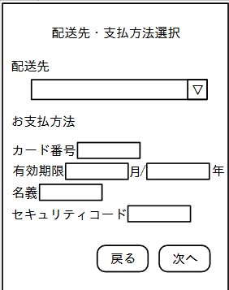

設問1
a 5
b クロスサイトスクリプティング
c 格納
d 2
e SQLインジェクション
設問2
(1)

(2)
パラメータ名：order[Payment]
値：1
(3)addEventListener メソッドで配送先・支払方法選択画面の form 要素にイベントリスナーを登録し，submit 時にクレジットカード情報をクエリパラメータとしてi-sha.comに送信する。
設問3
(1)WebサーバのアクセスログのリクエストURIから情報を取得する。
(2)配送先・支払方法選択画面にアクセスしたアカウント名