# 用語関係マップ（混同しやすい用語の「関係」だけを整理）

「パスキーとWebAuthnは何が違う？」「OAuthとOpenID Connectはどっちが上？」のように、**個々の意味は知っているのに関係がわからない**用語を、群ごとに整理します。
各用語の詳しい説明や処理の流れは既存のまとめにあるので、ここでは**層（どのレイヤの話か）と包含関係**に絞ります。

## 0. 読み方：用語は4つの層のどれかに属する

混乱の多くは、**層の違う用語を同列に比べてしまう**ことが原因です。まず「その用語はどの層か」を判定します。

| 層 | 何を表すか | 例 |
|---|---|---|
| 概念・目的 | 実現したいこと、考え方 | 認証、認可、SSO、VPN、ゼロトラスト、PKI |
| 規格・仕様 | 文書として定められた取り決め（RFC、W3C、ISOなど） | WebAuthn、OAuth 2.0、SAML、X.509、IPsec、ISO/IEC 27001 |
| データ形式・部品 | 仕様の中でやり取りされるモノ | JWT、IDトークン、証明書、アサーション、SA |
| 実装・製品・通称 | 仕様を使った具体物や、市場での呼び名 | パスキー、Googleログイン、EDR製品、UTM、Let's Encrypt |
| 組織・役割 | 人やチーム | SOC、CSIRT、CA、IdP |

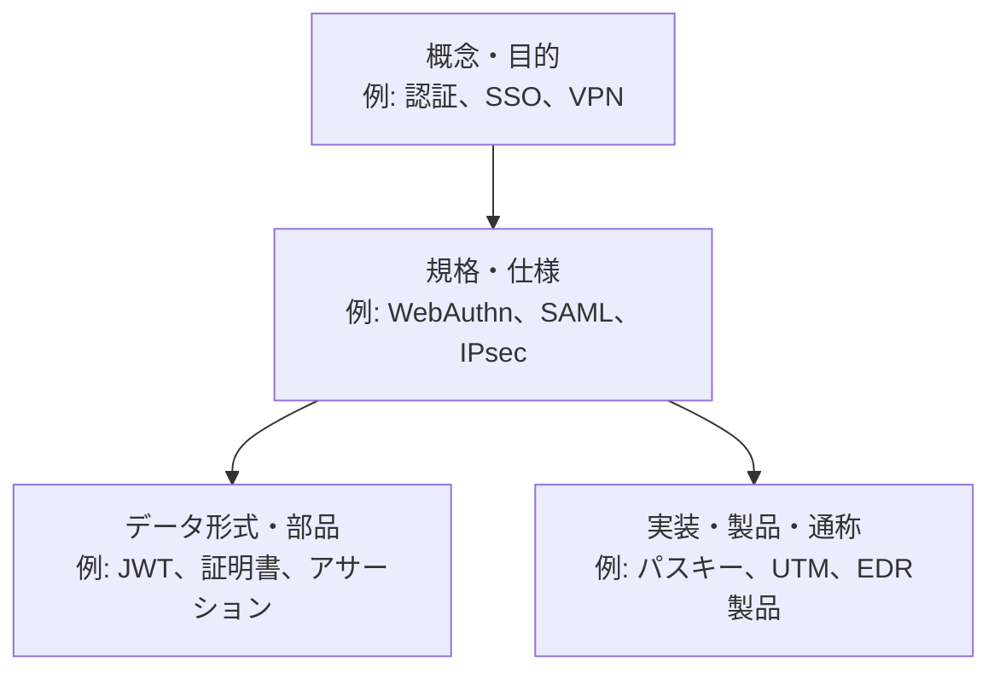

> 「AとBの違いは？」と聞かれたら、まず **「AとBは同じ層か？」** を確かめる。違う層なら「AはBを使って実現される」「AはBの一種」という関係で答える。

---

## 1. パスワードレス認証：パスキー／WebAuthn／CTAP／FIDO2

詳細（登録・認証フロー、チャレンジ、フィッシング耐性の理由）は [認証フローまとめ.md](認証フローまとめ.md) の「2. WebAuthn（パスキー）」。

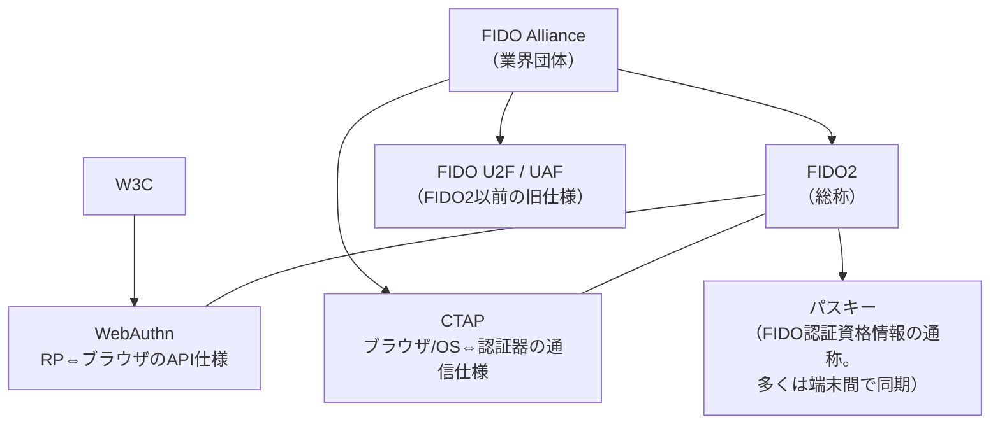

| 用語 | 層 | 一言で |
|---|---|---|
| FIDO2 | 規格の総称 | WebAuthn ＋ CTAP |
| WebAuthn | 規格（W3C） | Webサイト（RP）とブラウザの間のAPI |
| CTAP | 規格（FIDO Alliance） | ブラウザ/OSと認証器（USBキー、スマホ）の間の通信 |
| パスキー | 通称・実装 | FIDO2で使う鍵（クレデンシャル）。同期型が多い |
| 認証器（Authenticator） | 部品 | 秘密鍵を持ち、署名する装置。生体認証で鍵を開く |

**区別ポイント**
- 「パスキー」は仕様名ではなく**クレデンシャル（鍵ペア）の呼び名**。仕様はWebAuthn/CTAP。
- 生体情報は**サーバに送られない**。生体認証は端末内で秘密鍵を使う許可を出すだけ。サーバに届くのは署名。
- フィッシングに強いのは**RP ID（ドメイン）と鍵が結び付いている**から（→答案の根拠）。

---

## 2. ID連携：OAuth 2.0／OpenID Connect／SAML／JWT／各種トークン

フロー、`state`・`nonce`・PKCE、IDトークンの検証項目は [認証フローまとめ.md](認証フローまとめ.md) の3章・4章。SAMLの例は [用語集.md](用語集.md) の「SAML：深堀り」「SAML ResponseのXML例」。

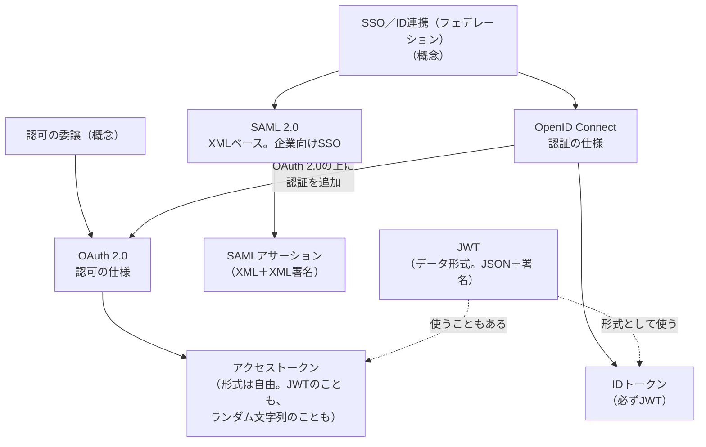

| 項目 | OAuth 2.0 | OpenID Connect | SAML 2.0 |
|---|---|---|---|
| 目的 | **認可**（APIを使う権限を渡す） | **認証**（誰がログインしたか） | 認証（＋属性）、SSO |
| 関係 | 土台 | OAuth 2.0の拡張 | 独立した別系統 |
| 発行物 | アクセストークン、リフレッシュトークン | ＋ **IDトークン（JWT）** | アサーション（XML） |
| 発行者 | 認可サーバ | OP（OpenIDプロバイダ） | IdP |
| 受け取る側 | クライアント（→リソースサーバへ提示） | RP | SP |
| 主な用途 | API連携、スマホアプリ | 「Googleでログイン」 | 社内システムとSaaSのSSO |

**トークンの区別**

| トークン | 誰が読む | 中身 | 使い道 |
|---|---|---|---|
| アクセストークン | リソースサーバ（API） | 権限（scope）。クライアントは中身を気にしない | APIを呼ぶ |
| リフレッシュトークン | 認可サーバ | － | アクセストークンの再発行 |
| IDトークン | RP（クライアント） | `iss`・`sub`・`aud`・`exp`・`nonce` | ログイン（本人確認） |
| 認可コード | 認可サーバ | － | トークンと交換する一時的な引換券 |

**区別ポイント**
- **JWTは「形式」、IDトークンは「役割」**。IDトークンは必ずJWTだが、JWTはIDトークン以外（アクセストークン、APIの独自トークン）にも使う。
- JWTは**署名（JWS）であって暗号化ではない**ので中身は読める。暗号化するならJWE。
- 「OAuthでログイン」は本来の使い方ではない → OIDCを使う（トークン置換攻撃の話）。
- Kerberosも認証＋SSOの仕組みだが、**社内（Active Directory）**で使うチケット方式。チケット（TGT）≒トークン、と対応付けると覚えやすい。

---

## 3. 暗号の基本部品：何を守るか

| 部品 | 鍵 | 守るもの | 典型例 |
|---|---|---|---|
| 共通鍵暗号 | 共通鍵 | 機密性 | AES（＋暗号利用モード: GCM、CTRなど） |
| 公開鍵暗号 | 公開鍵/秘密鍵 | 機密性、鍵配送 | RSA、ECDH（鍵交換） |
| ハッシュ関数 | なし | 改ざん検知（の材料） | SHA-256 |
| MAC（HMAC） | 共通鍵 | 完全性＋送信元確認（共有者のどちらか） | HMAC-SHA256 |
| デジタル署名 | 秘密鍵で署名、公開鍵で検証 | 完全性＋送信元確認＋**否認防止** | RSA署名、ECDSA |
| 認証付き暗号（AEAD） | 共通鍵 | 機密性＋完全性 | AES-GCM、ChaCha20-Poly1305 |

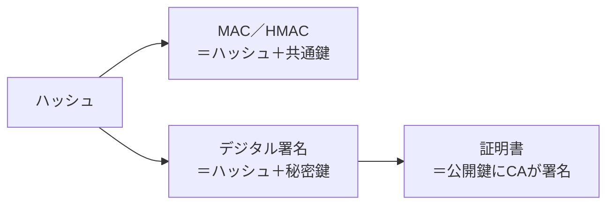

**区別ポイント**
- **MACは否認防止できない**（同じ鍵を相手も持っているので、どちらが作ったか区別できない）。否認防止は署名だけ。
- ハッシュ単体では改ざん検知にならない（攻撃者がハッシュも作り直せる）。鍵か署名が必要。

---

## 4. PKI・証明書・TLS

OCSPとOCSP Staplingは [用語集.md](用語集.md) の「OCSPとOCSP Stapling」。

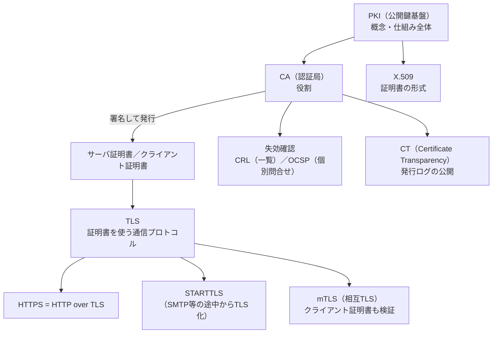

| 用語 | 層 | 一言で |
|---|---|---|
| PKI | 概念 | 「この公開鍵は本当にこの人のもの」を第三者（CA）が保証する仕組み全体 |
| X.509 | 規格（データ形式） | 証明書の書式 |
| 証明書 | 部品 | 公開鍵＋持ち主情報＋**CAの署名** |
| ルートCA／中間CA | 役割 | 信頼の起点と、その下で実際に発行するCA（証明書チェーン） |
| SSL | 旧仕様 | TLSの前身。脆弱なので使わない。「SSL証明書」は慣用名で中身はTLS用証明書 |
| TLS | 規格（プロトコル） | 通信の暗号化＋サーバ認証。1.3で鍵交換はECDHE（前方秘匿性）に限定 |
| HSTS | 仕様（HTTPヘッダ） | 「次からHTTPSでしか来るな」とブラウザに覚えさせる |

**区別ポイント**
- **証明書は暗号化に使う鍵そのものではない**。TLSの通信を暗号化するのは、鍵交換で作った**共通鍵**。証明書は「相手が本物か」の確認用。
- 証明書の検証項目: **署名（チェーン）、有効期限、失効していないか、ホスト名（SAN）が一致するか**。
- DV／OV／EV証明書の違いは「CAが何を確認したか」（ドメインのみ／組織の実在／より厳格）。暗号強度は同じ。

---

## 5. メールのセキュリティ

SPF・DKIM・DMARC・ARCの詳細は [メール認証まとめ.md](メール認証まとめ.md)。ここでは「送信ドメイン認証」と「それ以外」の位置関係だけ。

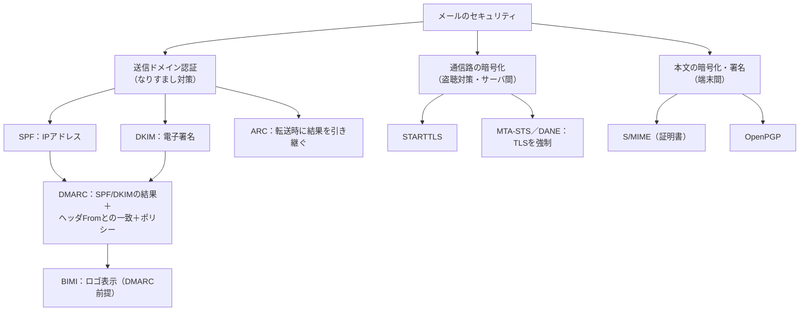

**区別ポイント**
- **SPF/DKIM/DMARCは暗号化ではない**。「送信元ドメインが詐称されていないか」の確認。
- STARTTLSは**サーバ間の区間ごと**の暗号化で、サーバ上では平文。端末間の機密性はS/MIME。
- DKIM署名（サーバが付ける、ドメイン単位）とS/MIME署名（送信者個人が付ける）は別物。

---

## 6. VPNと通信路の保護

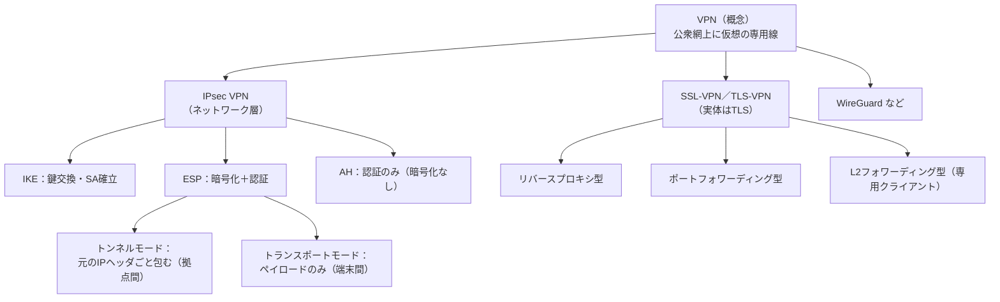

| 方式 | 層 | 用途 | 注意点 |
|---|---|---|---|
| IPsec | ネットワーク層 | 拠点間VPN、リモートアクセス | AHはNATと相性が悪い（IPヘッダを認証対象に含むため）→ NATトラバーサル |
| SSL-VPN | TLS（トランスポート層の上） | リモートアクセス | **VPN装置自体の脆弱性**が侵入口になる事例が頻出 |
| L2TP | トンネリングのみ | IPsecと組み合わせて使う（L2TP/IPsec） | 単体では暗号化しない |

**区別ポイント**
- 「VPN」は概念。試験で「VPN装置」と出たらSSL-VPN装置のことが多く、**脆弱性の悪用→認証情報窃取→横展開**の流れで出題される。
- ゼロトラストのZTNAは、VPNの「入ったら社内全部に届く」を置き換える考え方（→9章）。

---

## 7. 無線LANと社内ネットワークの認証

IEEE 802.1Xの構成図は [用語集.md](用語集.md) の「802.1Xの『ポートベース』」。

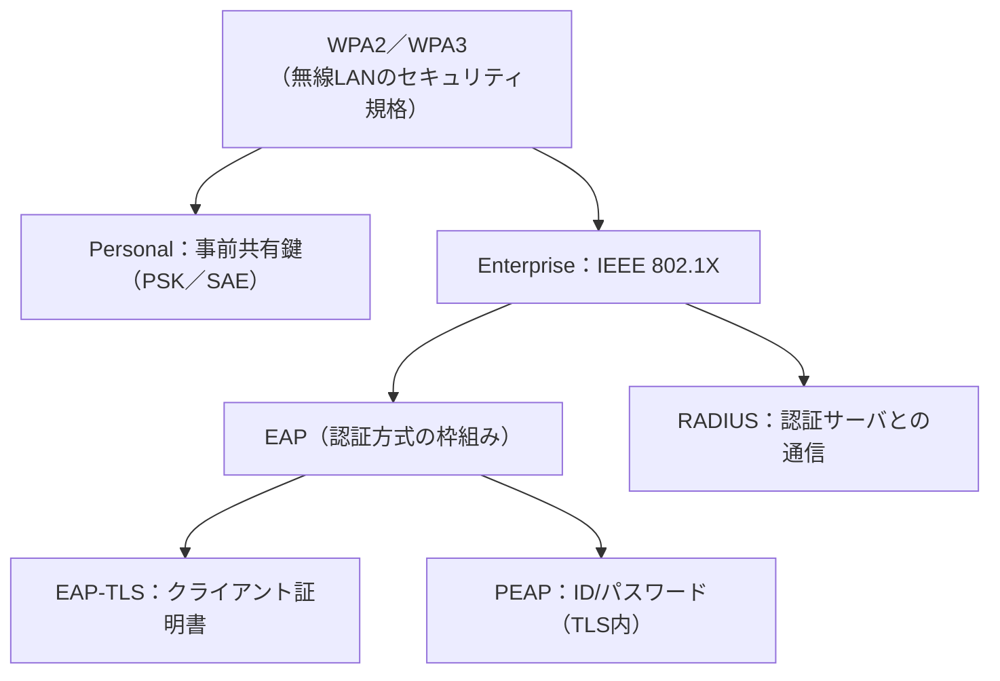

**区別ポイント**
- **802.1Xは無線専用ではない**（有線スイッチのポートにも使う）。
- WPA3-PersonalのSAEは、PSKと違い**オフライン辞書攻撃に強い**。
- Enhanced Open（OWE）は「パスワードなしでも暗号化」。**認証はしない**ので偽APは防げない。

---

## 8. 境界での防御：FW／IDS／IPS／WAF／UTM

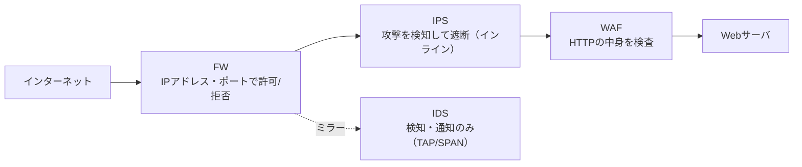

| 製品 | 見る範囲 | 動作 | 典型の守備範囲 |
|---|---|---|---|
| FW（パケットフィルタ型） | IP・ポート（L3/L4） | 遮断 | 不要な通信の遮断 |
| IDS | パケットの中身 | **検知・通知のみ** | 監視。通信を止めない（誤検知の影響なし） |
| IPS | パケットの中身 | **検知して遮断** | インライン配置。誤検知で業務通信も止まる |
| WAF | HTTPリクエスト/レスポンス | 遮断 | SQLインジェクション、XSS（→ [XSS3分類まとめ.md](XSS3分類まとめ.md)） |
| UTM | 上記をまとめた1台 | － | 中小企業向け。単一障害点 |
| NGFW | アプリケーション単位で識別 | 遮断 | 「どのアプリの通信か」で制御 |

**区別ポイント**
- **HTTPS通信の中身はFW/IPSから見えない**。WAFはTLS終端の後ろ（またはWAF自身で終端）に置く。
- 検知方式: **シグネチャ型**（既知の攻撃に強い、未知に弱い）／**アノマリ型**（通常との差で検知。未知に強いが誤検知が多い）。
- 誤検知（フォールスポジティブ）と見逃し（フォールスネガティブ）の言い分けを答案で正確に。

---

## 9. 端末・クラウドの防御：EPP／EDR／XDR、ゼロトラスト関連

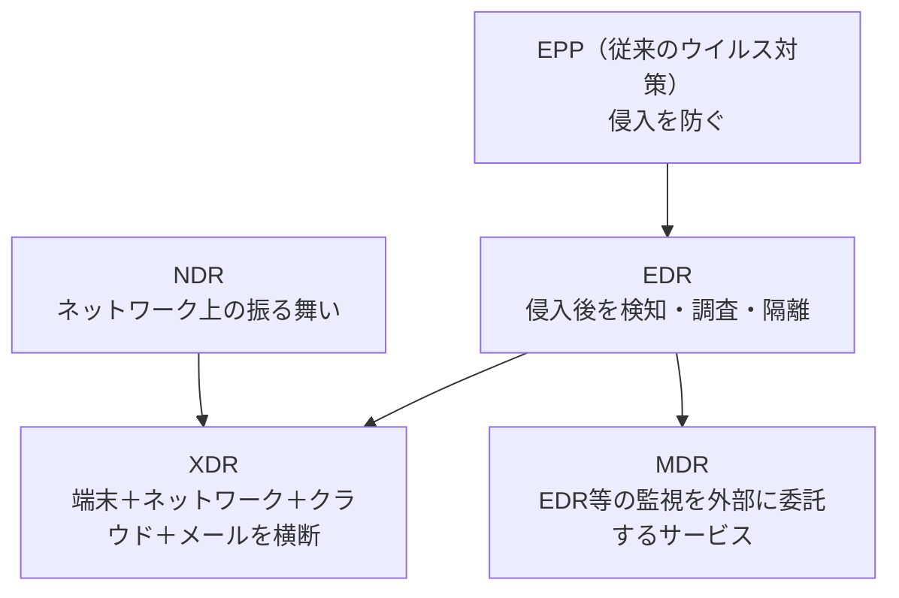

| 用語 | 層 | 一言で |
|---|---|---|
| EPP | 製品分類 | マルウェアを**実行させない**（パターン、振る舞い） |
| EDR | 製品分類 | 端末の操作ログを記録し、**侵入後に**検知・調査・端末隔離 |
| XDR | 製品分類 | EDRを端末以外にも広げ、相関分析 |
| MDR | サービス | 監視・対応をする人（SOC機能）ごと外部委託 |

ゼロトラストまわり（概念と、それを実現する製品分類）:

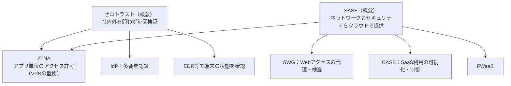

**区別ポイント**
- **EPPは「入れない」、EDRは「入られた後」**。EDRがあっても侵入は防げない前提で答える。
- ゼロトラストとSASEは**どちらも概念**。ZTNA・SWG・CASBはそれを実現する製品分類。
- CASBは「どのSaaSを誰が使っているか（シャドーIT）」の可視化が定番の答え。

---

## 10. 監視と対応の組織・仕組み：SIEM／SOAR／SOC／CSIRT／PSIRT

インシデント対応の答案の型は [頻出テーマ別_解答パターン.md](頻出テーマ別_解答パターン.md) の「5. インシデント対応・ログ解析」。

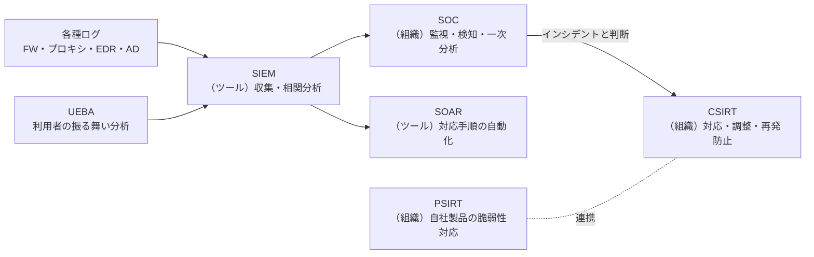

| 用語 | 種類 | 一言で |
|---|---|---|
| SIEM | ツール | ログを集めて**相関分析**し、アラートを出す |
| SOAR | ツール | アラートを受けた**対応手順（プレイブック）を自動化** |
| UEBA | ツール/機能 | 利用者・端末の普段と違う振る舞いを検知（内部不正、アカウント乗っ取り） |
| SOC | 組織 | 24時間監視。**検知・分析**が中心 |
| CSIRT | 組織 | インシデント**対応**の窓口・司令塔。社内外との調整 |
| PSIRT | 組織 | 自社が**提供する製品**の脆弱性に対応 |

**区別ポイント**
- **SIEMはツール、SOCは組織**。SOCがSIEMを使って監視する。
- SOCは「見つける」、CSIRTは「対応する・調整する」。SOCを持たずCSIRTだけの組織も多い。
- CSIRTとPSIRTは**守る対象が違う**（自組織のシステム／自社製品を使う顧客）。

---

## 11. 脆弱性の識別・評価：CVE／CWE／CVSS／JVN／SBOM

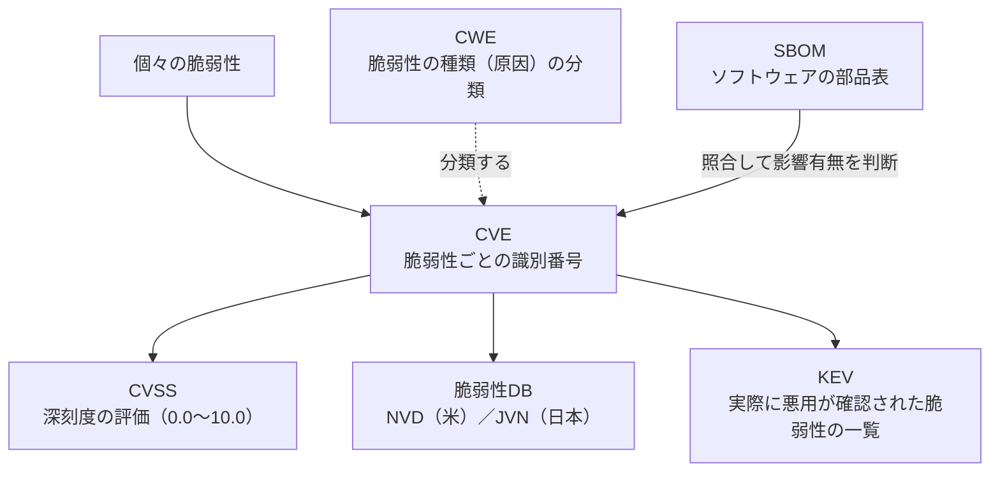

| 用語 | 何の番号・指標か | 例 |
|---|---|---|
| CVE | **個々の**脆弱性のID | CVE-2021-44228（Log4Shell） |
| CWE | 脆弱性の**種類** | CWE-79（XSS）、CWE-89（SQLインジェクション） |
| CVSS | 深刻度 | 基本値（製品固有）／現状値（攻撃コードの有無）／環境値（自組織での影響） |
| SBOM | 使っているOSSなどの部品一覧 | 新しいCVEが出たとき、影響する製品をすぐ特定できる |

**区別ポイント**
- **CVEは「どれ」、CWEは「どんな種類」、CVSSは「どれくらい危ないか」**。
- CVSSの基本値が高くても、**環境値**（自組織で外部公開していない等）で優先度は変わる。
- SBOMの効用を問われたら「脆弱性が公表された際に、影響を受ける製品・バージョンを速やかに特定できる」。

---

## 12. 管理の規格・フレームワーク：ISMS／ISO 27001／27002／NIST CSF

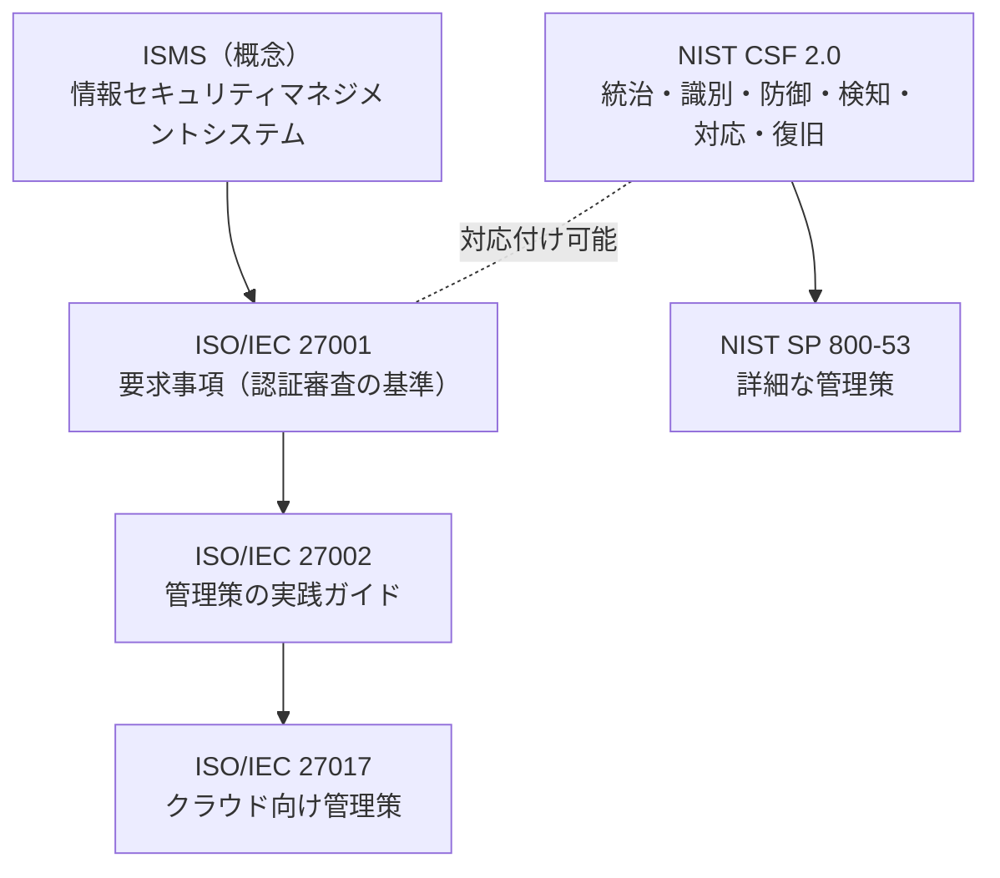

**区別ポイント**
- **27001は「何をしなければならないか（shall）」、27002は「どうやるか」**。認証を取得するのは27001。
- NIST CSF 2.0で追加されたのは **GOVERN（統治）**（→ [用語集.md](用語集.md) の「NIST CSF 2.0のGOVERN」）。
- CC（ISO/IEC 15408）は**製品**の評価、ISMSは**組織**の評価。

---

## 13. まとめて見る：「同じ層の仲間」と「上下関係」早見表

| 混同しやすいペア | 関係 | 覚え方 |
|---|---|---|
| パスキー ⇔ WebAuthn | 実装（鍵） ⇔ 仕様 | パスキーをWebAuthnで使う |
| FIDO2 ⇔ WebAuthn | 総称 ⇔ その一部 | FIDO2 ＝ WebAuthn ＋ CTAP |
| OAuth ⇔ OpenID Connect | 土台 ⇔ 拡張 | OIDC ＝ OAuth ＋ IDトークン（認証） |
| OIDC ⇔ SAML | 同じ層の別仕様 | JSON/JWT ⇔ XML |
| JWT ⇔ IDトークン | 形式 ⇔ 役割 | IDトークンはJWTで書く |
| PKI ⇔ 証明書 ⇔ TLS | 仕組み ⇔ 部品 ⇔ それを使うプロトコル | TLSは証明書でサーバを確認 |
| SSL ⇔ TLS | 旧版 ⇔ 現行版 | 「SSL」は慣用名 |
| DKIM ⇔ S/MIME | ドメイン単位の署名 ⇔ 個人の署名 | 誰が付けるか |
| VPN ⇔ IPsec | 概念 ⇔ 実現方式 | IPsecはVPNの作り方の一つ |
| IDS ⇔ IPS | 同じ層 | 止めるかどうか |
| EPP ⇔ EDR | 同じ層 | 侵入前か後か |
| SIEM ⇔ SOC | ツール ⇔ 組織 | SOCがSIEMを使う |
| SOC ⇔ CSIRT | 同じ層（組織） | 見つける ⇔ 対応する |
| CVE ⇔ CWE ⇔ CVSS | ID ⇔ 種類 ⇔ 深刻度 | どれ・どんな・どれくらい |
| ISO 27001 ⇔ 27002 | 要求事項 ⇔ 実践ガイド | 認証は27001 |
| ゼロトラスト ⇔ ZTNA | 概念 ⇔ 製品分類 | ZTNAでゼロトラストを実現 |

---

## 関連
- [認証フローまとめ.md](認証フローまとめ.md)：WebAuthn、OAuth・PKCE、OIDCの処理の流れ
- [メール認証まとめ.md](メール認証まとめ.md)：SPF・DKIM・DMARC・ARCの仕組みと答案の型
- [XSS3分類まとめ.md](XSS3分類まとめ.md)：XSSの分類と対策
- [用語集.md](用語集.md)：SAML、OCSP、802.1X、NIST CSFなどの個別解説
- [頻出テーマ別_解答パターン.md](頻出テーマ別_解答パターン.md)：テーマ別の答案の型
