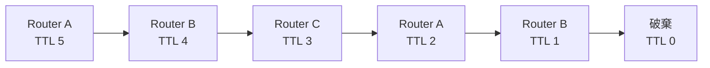
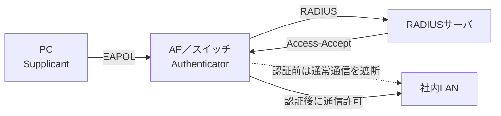
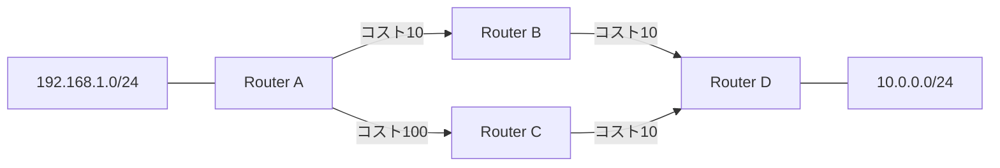
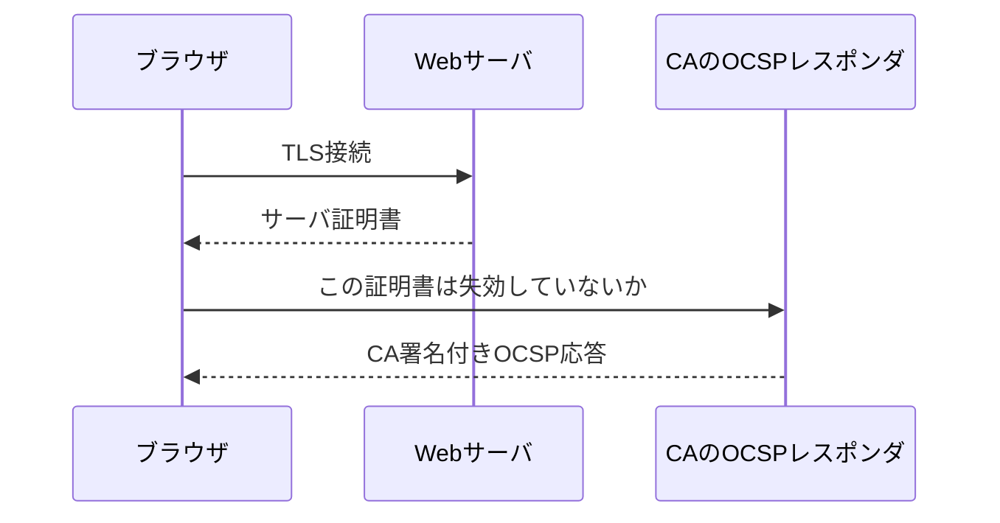
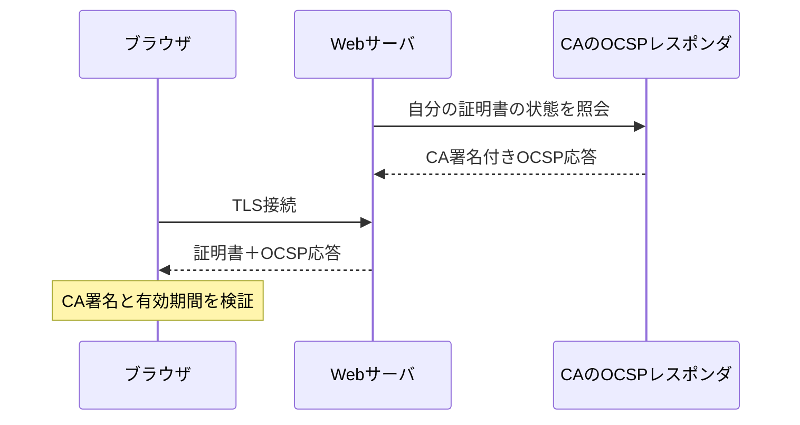
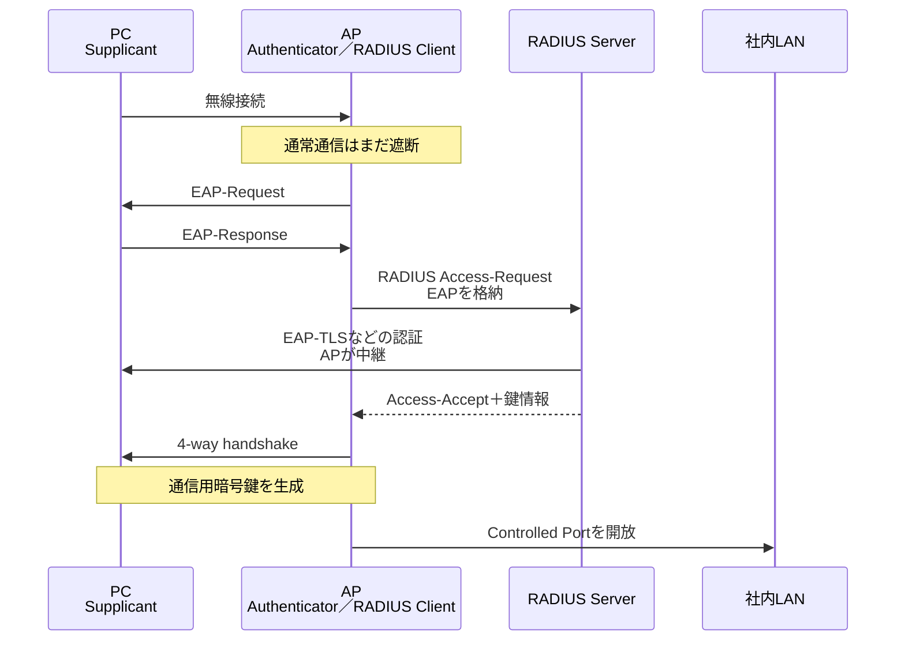

# DB

```
DBMS
├─ メモリ領域
│  ├─ バッファプール
│  ├─ SQL／実行計画キャッシュ
│  └─ ソート・結合用ワークメモリ
│
├─ 永続データ領域
│  ├─ ユーザーデータ
│  ├─ インデックス
│  └─ データディクショナリ／システムカタログ
│
├─ 一時領域
│  └─ ソート・結合・中間結果
│
├─復旧用ログ領域
│  ├─ REDO／トランザクションログ／WAL
│  ├─ UNDO／ロールバック領域
│  └─ アーカイブログ
│
├─ 監査用ログ領域
│  └─ 監査ログ／クエリログ
│
└─ 外部の復旧資産
   └─ フル・差分・増分バックアップ
```


| 関係モデルの用語 | SQLでの呼び方 | 上の例 |
|---|---|---|
| 関係（relation） | 表、テーブル | 従業員表全体 |
| 属性（attribute） | 列、カラム | `employee_id`、`name` |
| タプル（tuple） | 行、レコード | `101, 佐藤, 10, 105` |
| 定義域（domain） | データ型＋値の意味的範囲 | 従業員番号、部署番号 |
| 関係スキーマ | 表の構造・定義 | 列名、型、キーなど |
| 関係値 | ある時点で入っている行の集合 | 現在の従業員データ |

「relational」という名前は、表同士に「関連がある」という意味から付いたのではありません。数学的な relation（関係） を基礎にしていることが由来です。
属性の定義域を次のようにします。
従業員番号の集合 × 氏名の集合 × 部署番号の集合
この直積から、実際に存在する組合せを選んだ集合が「関係」です。

# Network
```
アプリケーション
────────────────────────
L3 ネットワーク層：IPパケット
    ルータ、L3スイッチ
────────────────────────
L2 データリンク層：イーサネットフレーム
    ブリッジ、L2スイッチ、無線AP
────────────────────────
L1 物理層：電気・光・電波の信号
    リピータ、ハブ
```
| 機器 | 主に見る情報 | 中継単位 | 主な判断材料 |
|---|---|---|---|
| ハブ | 信号 | ビット | 判断せず全ポートへ複製 |
| ブリッジ | MACアドレス | フレーム | MACアドレステーブル |
| L2スイッチ | MACアドレス | フレーム | MACアドレステーブル |
| ルータ | IPアドレス | IPパケット | ルーティングテーブル |
| L3スイッチ | MACとIP | フレーム／IPパケット | MACテーブルとルーティングテーブル |
```
ブリッジ
└─ 少数ポートのL2中継装置

L2スイッチ
└─ 多ポート化・高速化したブリッジ
```

**ハブの場合**
ハブは受信した信号を全ポートに複製します。
```
A ─┐
B ─┼─ ハブ ─ C
D ─┘
```
全体が一つのコリジョンドメイン
あるポートで発生した衝突の影響が全体に及びます。

**スイッチの場合**
スイッチはポートごとに通信を分離します。
```
A ── スイッチ ── B
       │
       C
````
各ポートが別のコリジョンドメインです。さらに、現在一般的な全二重通信では、送信と受信に別の経路を使うので、原理上コリジョンは発生しません。

**ルータの場合**

ルータは受信したイーサネットフレームをそのまま反対側へ流しません。
- 受信したフレームを検査する
- 正常なフレームからIPパケットを取り出す
- ルーティングテーブルで転送先を決める
- 別の新しいフレームを作る
- 別インタフェースから送信する

**MACブロードキャスト**

イーサネットのブロードキャストMACアドレス
`FF:FF:FF:FF:FF:FF`
全48ビットが1です。

同じL2ネットワークにいる全端末へ送信するときに使います。代表例はIPv4のARP要求です。

「192.168.1.1を持っている端末は、
  あなたのMACアドレスを教えてください」

送信先MACアドレスが分からないので、同じネットワーク全体へ問い合わせます。
```
送信元PC
   │ FF:FF:FF:FF:FF:FF
   ▼
スイッチ
 ├─ PC-Bへ
 ├─ PC-Cへ
 └─ ルータのインタフェースへ
```
スイッチは通常、同じVLAN内の全ポートへブロードキャストフレームを転送します。
しかし、ルータはそのブロードキャストフレームを別のネットワークへ中継しません。

```
セグメントA                  セグメントB

PC-A ─ スイッチ ─ ルータ ─ スイッチ ─ PC-B
          └──────×──────┘
       L2ブロードキャストは越えない
```

このため、ルータのインタフェースごとに ブロードキャストドメイン が分割されます。

**ルータはなぜMACフレームをそのまま転送しないのか**

例えば、PC-Aから別ネットワークのPC-Bへ通信するとします。

```
PC-A
IP：192.168.1.10
MAC：AA-AA-AA-AA-AA-AA

ルータ左
IP：192.168.1.1
MAC：RR-RR-RR-RR-R1

ルータ右
IP：192.168.2.1
MAC：RR-RR-RR-RR-R2

PC-B
IP：192.168.2.20
MAC：BB-BB-BB-BB-BB-BB
```

PC-Aが最初に送るフレームは次のようになります。

```
イーサネットフレーム
送信元MAC：PC-A
宛先MAC　：ルータ左

IPパケット
送信元IP：PC-A
宛先IP　：PC-B
```
PC-Aは、PC-Bが別ネットワークにいると判断し、フレームをデフォルトゲートウェイであるルータへ送ります。
ルータは、そのフレームからIPパケットを取り出します。そして右側へ送るために、次の新しいフレームを作ります。
```
新しいイーサネットフレーム
送信元MAC：ルータ右
宛先MAC　：PC-B

IPパケット
送信元IP：PC-A
宛先IP　：PC-B
```
つまり、
- IPアドレスは基本的に通信の両端を表す
- MACアドレスはそのリンク上での次の送り先を表す
- ルータを通るたびにイーサネットヘッダーは作り直される
という関係です。

```
PC-A → ルータ
MAC：PC-A → ルータ
IP ：PC-A → PC-B

ルータ → PC-B
MAC：ルータ → PC-B
IP ：PC-A → PC-B
```
だから、片側で受信したブロードキャストMACアドレスを、そのまま反対側へ中継する動作にはなりません。

```
ハブ
└─ コリジョンもブロードキャストも止めない

スイッチ
├─ コリジョンは分割
└─ ブロードキャストは同じVLAN内に転送

ルータ
├─ コリジョンを分割
└─ ブロードキャストも分割
```

**VLANとアクセスポート・トランクポート**
一台のスイッチを、論理的に複数のL2ネットワークへ分割する技術がVLANです。
```
一台のスイッチ
├─ VLAN 10：開発部
└─ VLAN 20：営業部
```
VLAN 10のブロードキャストはVLAN 20には届きません。

物理的には同じスイッチ
論理的には別のブロードキャストドメイン

**アクセスポート**
基本的に一つのVLANに所属し、PCやプリンタなどを接続するポートです。

```
PC ── アクセスポート ── スイッチ
             VLAN 10
```
通常、端末側とのフレームにはVLANタグを付けません。

**トランクポート**
複数のVLANのフレームを一本のリンクで運ぶポートです。
```
                     VLAN 10
スイッチA ═════════ スイッチB
                     VLAN 20
                     VLAN 30
          トランクリンク
```
どのVLANのフレームかを識別するため、一般にIEEE 802.1Qタグを付けます。
なお、アクセスポートとトランクポートはVLANの運搬方法を表す用語です。これから説明するSTPの「ルートポート」「代表ポート」は、ループ制御上の役割を表します。分類軸が異なります。
一つの物理ポートが、
トランクポートであり、
STP上は代表ポート
ということもあります。

| 観点 | L2スイッチ | ルータ／L3スイッチ |
|---|---|---|
| 主に扱う層 | L2 | L3 |
| 主に見る宛先 | MACアドレス | IPアドレス |
| 参照する表 | MACアドレステーブル | ルーティングテーブル |
| 中継対象 | イーサネットフレーム | IPパケット |
| MACブロードキャスト | 同一VLAN内へ転送 | 原則として別ネットワークへ転送しない |
| コリジョン | ポートごとに分割 | インタフェースごとに分割 |
| ブロードキャストドメイン | VLANごと | インタフェース・VLANごと |
| ループ対策 | STP/RSTP | TTLやルーティング制御 |
| ネットワーク間通信 | 原則できない | できる |
| 主な冗長化 | STP、リンクアグリゲーション | 動的ルーティング、VRRPなど |


# 1. IPv4アドレスとサブネット

IPv4アドレスは32ビットで構成されます。

```text
192.168.10.25
```

これを2進数にすると、32個のビットになります。
（10進数を2で割り続けて、逆順で余りをくっつける）

```text
11000000.10101000.00001010.00011001
```
```
25 / 2 = 12 ... 1
12 / 2 = 6  ... 0
 6 / 2 = 3  ... 0
 3 / 2 = 1  ... 1
 1 / 2 = 0  ... 1
```


この32ビットを、サブネットマスクによって次の二つに分けます。

```text
ネットワーク部 ｜ ホスト部
```

例えば`192.168.10.25/24`なら、

```text
IPアドレス
11000000.10101000.00001010.00011001

サブネットマスク
11111111.11111111.11111111.00000000
←──── ネットワーク部 ────→←ホスト部→
```

`/24`は「先頭24ビットがネットワーク部」という意味です。

サブネットマスクは次のようになります。

```text
11111111.11111111.11111111.00000000
   255  .   255  .   255  .    0
```

## R5秋 問18

> クラスCのネットワークを、50ノードずつ収納できる四つのサブネットに分割した場合のサブネットマスク

**255.255.255.192** です。

CIDR表記では`/26`です。

## 四つに分割するためのビット数

クラスCのデフォルトのサブネットマスクは`/24`です。

```text
ネットワーク部：24ビット
ホスト部　　　： 8ビット
```

四つのサブネットを作るには、ホスト部から2ビットをサブネット番号として借ります。

```text
2^2 = 4サブネット
```

したがって、

```text
元のネットワーク部 24ビット
＋
借りたビット        2ビット
＝
26ビット
```

サブネットマスクは`/26`になります。

```text
11111111.11111111.11111111.11000000
   255  .   255  .   255  .   192
```


サブネットマスクは、1が左から連続して並ばなければなりません。

```text
有効：11111111  = 255
有効：11000000  = 192
有効：10000000  = 128
無効：01000000  = 64
```

`255.255.255.64`は、有効なサブネットマスクではありません。

```text
64 = 01000000
```

# 2. R3秋 問20：ホスト数の計算

> クラスBのIPアドレスで、サブネットマスクが16進数の`FFFFFF80`である場合、利用可能なホスト数は最大幾つか。

正解は、 **126** です。

## 16進数のサブネットマスクを変換する

`FFFFFF80`
それぞれ2進数へ変換します。

```text
F = 1111
8 = 1000
0 = 0000
```

```text
16進数：FFFFFF80

10進数：255.255.255.128

2進数：11111111.11111111.11111111.10000000
```

1が25個あるため、`/25`です。

利用可能なホスト数は、

```text
2^7 - 2
= 128 - 2
= 126
```

となります。


## サブネット計算の基本式

```text
ホスト部のビット数
= 32 - プレフィックス長

1サブネットの総アドレス数
= 2^(ホスト部のビット数)

通常の利用可能ホスト数
= 2^(ホスト部のビット数) - 2
```

代表例は次のとおりです。

| CIDR | マスク | 総アドレス数 | 通常の利用可能ホスト数 |
|---:|---|---:|---:|
| `/24` | `255.255.255.0` | 256 | 254 |
| `/25` | `255.255.255.128` | 128 | 126 |
| `/26` | `255.255.255.192` | 64 | 62 |
| `/27` | `255.255.255.224` | 32 | 30 |
| `/28` | `255.255.255.240` | 16 | 14 |
| `/29` | `255.255.255.248` | 8 | 6 |
| `/30` | `255.255.255.252` | 4 | 2 |

`/31`はポイントツーポイントリンクで特別な使い方がありますが、基本問題ではまず`2^n-2`で考えて構いません。

# 3. IPv4のクラス

かつてIPv4アドレスは、先頭部分によってクラスA～Eに分類されていました。

| クラス | 第1オクテット | 元来の用途 | デフォルトマスク |
|---|---:|---|---|
| A | 1～126 | 大規模ネットワーク | `/8` |
| B | 128～191 | 中規模ネットワーク | `/16` |
| C | 192～223 | 小規模ネットワーク | `/24` |
| D | 224～239 | マルチキャスト | なし |
| E | 240～255 | 実験・予約 | なし |

`127.x.x.x`はループバック用なので、通常のクラスAホストアドレスには使いません。

## R4秋 問19

> クラスDのIPアドレスを使用するのはどの場合か。

正解は、 **マルチキャストアドレスを割り振る** です。

クラスDはCIDR表記では、

```text
224.0.0.0/4
```

です。

クラスDは個々の端末に通常のホストアドレスとして割り当てるものではなく、マルチキャストグループを識別します。

# 4. ユニキャスト・ブロードキャスト・マルチキャスト

IP通信の宛先は、主に次のように分類できます。

| 種類 | 通信相手 | イメージ |
|---|---|---|
| ユニキャスト | 1対1 | 特定の一台へ |
| ブロードキャスト | 1対同一ネットワークの全員 | 同じネットワーク全体へ |
| マルチキャスト | 1対グループ | 参加している複数端末へ |
| エニーキャスト | 1対最寄りの一台 | 同じアドレスを持つ最適な一台へ |

```text
ユニキャスト
送信者 ──→ 受信者A

ブロードキャスト
         ┌→ A
送信者 ─┼→ B
         └→ C

マルチキャスト
         ┌→ 参加者A
送信者 ─┤
         └→ 参加者C
            Bは不参加

エニーキャスト
送信者 ──→ 同じアドレスを持つ最寄りのサーバ
```

## R5秋 問19

> 複数ノードから成るグループにマルチキャストでデータを送るときに、宛先として使用できるIPアドレスはどれか。

正解は、 **239.0.1.1** です。

239はクラスDの範囲である224～239に含まれます。

### プライベートIPv4アドレス

インターネット上で直接経路制御されず、組織内で使用するアドレスです。

```text
10.0.0.0/8
172.16.0.0/12
192.168.0.0/16
```

したがって、`10.0.1.1`と`192.168.1.1`はプライベートアドレスですが、どちらも通常のユニキャストアドレスです。

### ループバックアドレス

```text
127.0.0.0/8
```

は自分自身を表します。

最も有名なのは、

```text
127.0.0.1
```

です。`127.0.1.1`も同じループバック範囲に含まれます。

### 239.0.0.0/8

`239.0.0.0/8`は、組織内で使用する管理スコープのマルチキャストアドレスです。プライベートアドレスに近い位置付けで、組織内マルチキャストに使われます。

## マルチキャストへの参加

受信者は、特定のマルチキャストグループへの参加を表明します。

```text
送信先グループ：239.0.1.1

PC-A：参加
PC-B：不参加
PC-C：参加
```

送信者が`239.0.1.1`へ送ると、参加しているAとCが受信します。

IPv4では、ホストがルータへグループ参加を通知するために、主にIGMPを使用します。ルータ間でマルチキャスト配送経路を作る際にはPIMなどが使われます。

# 5. 2種類のIPv4ブロードキャスト

## R5春 問20

正解は、

**ア　192.168.10.255と255.255.255.255とは、ともにサブネット内のブロードキャストに使用される**

です。

ただし、この二つには意味の違いがあります。

## ディレクテッドブロードキャスト

```text
192.168.10.255
```

は、`192.168.10.0/24`という特定のサブネットを指定するブロードキャストアドレスです。

`/24`では最後の8ビットがホスト部です。


特定のネットワークを宛先としているため、サブネット指向ブロードキャストやディレクテッドブロードキャストと呼ばれます。

同じサブネット内のホストからも使用できます。

理論上は、別ネットワークから`192.168.10.255`へ送信し、最終ルータが`192.168.10.0/24`全体へ展開することも考えられます。しかし、増幅攻撃などに悪用されるため、現在のルータでは外部からのディレクテッドブロードキャスト転送は一般に無効化されています。

## リミテッドブロードキャスト

```text
255.255.255.255
```

は、送信元が現在接続しているローカルネットワーク全体を意味します。

特徴は次のとおりです。

- 自分が所属しているローカルネットワーク宛て
- ルータを越えない
- 自分のネットワーク情報がまだ分からなくても使用できる

例えば、起動直後の端末は自分のIPアドレスやネットワークアドレスをまだ知りません。その状態でDHCPサーバを探す際に、`255.255.255.255`宛てのブロードキャストを使用できます。

```text
DHCPクライアント
「自分のIPもネットワークもまだ分からない」
        │
        │ 255.255.255.255
        ▼
同じネットワーク内のDHCPサーバ
```

## 二つの違い

| アドレス | 名称 | 対象 | ルータ越え |
|---|---|---|---|
| `192.168.10.255` | ディレクテッドブロードキャスト | 指定された`192.168.10.0/24` | 理論上可能だが通常は無効 |
| `255.255.255.255` | リミテッドブロードキャスト | 送信元のローカルネットワーク | 不可 |

どちらも同一サブネット内のブロードキャストに使用できるので、アが正解です。

IPレイヤでは異なるアドレスですが、イーサネット上では通常、どちらも宛先MACアドレスとして次を使用します。

```text
FF:FF:FF:FF:FF:FF
```

# 6. VRRPによるデフォルトゲートウェイの冗長化

## R4秋 問20

> クライアントの設定を変えることなくデフォルトゲートウェイの障害を回避するために用いられるプロトコル

正解は、

**エ　VRRP**

です。

VRRPは、**Virtual Router Redundancy Protocol**の略です。

## 通常のデフォルトゲートウェイ

クライアントが別のネットワークへ送信するときは、デフォルトゲートウェイへパケットを渡します。

```text
PC
IP：192.168.1.10
デフォルトゲートウェイ：192.168.1.1
                 │
                 ▼
              ルータ
```

ルータが一台しかない場合、そのルータが故障すると外部へ通信できません。

```text
PC ──×── 故障したルータ ── インターネット
```

単純にルータを二台置いても、PCに設定したデフォルトゲートウェイは一つなので、自動的には切り替わりません。

## VRRPの構成

VRRPでは、複数のルータで一つの仮想ルータを作ります。

```text
クライアントが設定する
デフォルトゲートウェイ
192.168.1.1（仮想IP）
         │
     仮想ルータ
      ┌──┴──┐
      │     │
  ルータA  ルータB
  Master   Backup
```

クライアントには、個々のルータの実IPアドレスではなく、仮想IPアドレスをデフォルトゲートウェイとして設定します。

```text
仮想IP：192.168.1.1

ルータA実IP：192.168.1.2
ルータB実IP：192.168.1.3
```

正常時はマスタールータが仮想IPを担当します。

```text
PC → 192.168.1.1 → ルータA
```

ルータAが故障すると、バックアップルータが仮想IPと仮想MACアドレスを引き継ぎます。

```text
PC → 192.168.1.1 → ルータB
```

クライアントから見るデフォルトゲートウェイは、障害の前後で変わりません。

```text
障害前：192.168.1.1
障害後：192.168.1.1
```

このため、「クライアントの設定を変えることなく」障害を回避できます。

## 他の選択肢

| プロトコル | 用途 |
|---|---|
| RARP | MACアドレスからIPv4アドレスを得る古いプロトコル |
| RSTP | L2ネットワークのループを防ぎ、高速に経路を切り替える |
| RTSP | 動画・音声などのストリーミング制御 |
| VRRP | デフォルトゲートウェイの冗長化 |

RSTPも障害時に経路を切り替えるため混同しやすいですが、対象が違います。

```text
RSTP
→ スイッチ間のL2経路を冗長化

VRRP
→ クライアントのデフォルトゲートウェイを冗長化
```

# 7. IPv6の特徴

## R4秋 問18

正解は、

**エ　ヘッダーは固定長であり、拡張ヘッダー長は8オクテットの整数倍である**

です。

ここでいう「ヘッダーが固定長」とは、IPv6の **基本ヘッダー** が固定長という意味です。

## IPv4とIPv6の大きな違い

| 項目 | IPv4 | IPv6 |
|---|---|---|
| アドレス長 | 32ビット | 128ビット |
| 基本ヘッダー | 可変長 | 40バイト固定 |
| ARP | 使用する | 使用しない |
| 近隣探索 | ARP | ICMPv6のNDP |
| ルータでのフラグメント | 可能 | 行わない |
| ブロードキャスト | ある | ない |
| マルチキャスト | ある | ある |

## ア：ARPは使わない

> IPv6アドレスからMACアドレスを調べる際にARPを使う。

誤りです。

IPv6ではARPの代わりに、ICMPv6を基礎とする **NDP（Neighbor Discovery Protocol）** を使います。

主なメッセージは次の二つです。

- Neighbor Solicitation：MACアドレスなどを問い合わせる
- Neighbor Advertisement：問い合わせに回答する

IPv4では、

```text
ARP Request
「192.168.1.10を持っている人は誰？」
```

IPv6では、

```text
Neighbor Solicitation
「このIPv6アドレスを持っているノードは誰？」
```

という形になります。

IPv6にはブロードキャストがないため、NDPではマルチキャストを利用します。

## イ：増加倍率は2^96倍

> アドレス空間はIPv4の2^128倍である。

誤りです。

IPv4のアドレス数は、

```text
2^32
```

IPv6のアドレス数は、

```text
2^128
```

したがって、IPv4からIPv6への増加倍率は、

```text
2^128 ÷ 2^32
= 2^(128-32)
= 2^96
```

です。

```text
IPv6のアドレス数：2^128
IPv4に対する倍率：2^96
```

ここを取り違えないようにします。

## ウ：ルータはフラグメンテーションしない

> 経路の途中でフラグメンテーションを行うことが可能である。

IPv6の特徴としては誤りです。

IPv4では、経路上のルータが、次のリンクのMTUに合わせてパケットを分割することがあります。

```text
IPv4送信元
   │ 大きなパケット
   ▼
ルータ
   │ 分割
   ├─ 断片1
   ├─ 断片2
   └─ 断片3
```

IPv6では、中継ルータはフラグメンテーションを行いません。

パケットが次のリンクのMTUより大きい場合、ルータはICMPv6の「Packet Too Big」を送信元へ返します。

```text
IPv6送信元
   │ 大きすぎるパケット
   ▼
ルータ
   │
   └─ Packet Too Bigを送信元へ通知
```

必要なら、送信元がFragment拡張ヘッダーを使って分割します。

```text
IPv4：途中のルータも分割できる
IPv6：送信元だけが分割する
```

## エ：基本ヘッダーは40バイト固定

IPv6の基本ヘッダーは40バイト固定です。

主なフィールドは次のとおりです。

- Version
- Traffic Class
- Flow Label
- Payload Length
- Next Header
- Hop Limit
- Source Address
- Destination Address

IPv4ではオプションによって基本ヘッダーの長さが変化しました。IPv6では基本ヘッダーを固定長にし、追加情報を拡張ヘッダーへ分離します。

```text
IPv6基本ヘッダー
    ↓ Next Header
拡張ヘッダー
    ↓ Next Header
別の拡張ヘッダー
    ↓ Next Header
TCP／UDP
    ↓
データ
```

代表的な拡張ヘッダーには次があります。

- Hop-by-Hop Options
- Routing Header
- Fragment Header
- Destination Options
- Authentication Header
- Encapsulating Security Payload

拡張ヘッダーは連鎖でき、基本的に8オクテット単位に整えられます。

なお、

```text
IPv6のヘッダー全体が常に40バイト
```

という意味ではありません。

正確には、

```text
基本ヘッダーは40バイト固定
＋
必要に応じて拡張ヘッダーが続く
```

という構造です。

# 全体のつながり

今回の範囲は、次のようにつながっています。

```text
IPv4／IPv6アドレス
      │
      ├─ サブネットマスクでネットワークを分割
      │       ├─ ネットワークアドレス
      │       ├─ ホストアドレス
      │       └─ IPv4ブロードキャストアドレス
      │
      ├─ 通信相手による分類
      │       ├─ ユニキャスト
      │       ├─ ブロードキャスト
      │       ├─ マルチキャスト
      │       └─ エニーキャスト
      │
      ├─ 別ネットワークへの通信
      │       └─ デフォルトゲートウェイ
      │               └─ VRRPで冗長化
      │
      └─ IPv6での変更
              ├─ 128ビット
              ├─ ARPではなくNDP
              ├─ ブロードキャストなし
              ├─ ルータはフラグメントしない
              └─ 40バイト固定の基本ヘッダー
```

試験用には、次を即答できる状態にしておくとよいです。

- `/25`は126ホスト、`/26`は62ホスト
- サブネットマスクの1は左から連続する
- 224～239はIPv4マルチキャスト
- `255.255.255.255`はローカル限定ブロードキャスト
- VRRPはデフォルトゲートウェイの冗長化
- IPv6ではARPではなくNDP
- IPv6のアドレス数は`2^128`、IPv4比では`2^96`倍
- IPv6では途中のルータはフラグメンテーションしない
- IPv6基本ヘッダーは40バイト固定

## 各問題の解説

### 1. データリネージ

正解はウです。

データリネージは、データが「どこから来て、どんな変換を受け、どこへ渡ったか」という系譜です。

- 発生源：業務DB、API、CSVなど
- 変換：抽出、結合、集計、匿名化など
- 出力先：DWH、データマート、帳票、機械学習モデルなど

障害時の影響調査、データ誤りの原因特定、個人情報の追跡、監査に使います。データ基盤では実務的な概念です。

他の選択肢は、アがアクセス制御、イがデータオーナーシップ、エがデータ辞書・技術メタデータです。

### 2. スパニングツリープロトコル(STP)

L2フレームにはIPのTTLに相当する仕組みがないため、スイッチ間にループがあると、ブロードキャストなどが回り続けます。その結果、ブロードキャストストームやMACアドレステーブルの不安定化が起きます。

STPは次のようにループのない木構造を作ります。

- BPDUでスイッチ同士が情報交換する
- ルートブリッジを選出する
- 各スイッチのルートポートを選ぶ
- 各リンクの代表ポートを選ぶ
- 余分な経路をブロックする
- 障害時にはブロックしていた経路を有効化する

「ループを防ぐ」だけでなく、なぜL2ループが危険か、ルートポート・代表ポートとの関係まで理解しておくべきテーマです。

STPは冗長経路の一部を待機状態にしておく仕組みです。収束を高速化したものがRSTPです。

### 4. リンクアグリゲーション

複数の物理ポートを一つの論理リンクとして束ね、帯域増加と冗長化を実現します。動的に構成を合意する代表的なプロトコルがLACPです。

注意点は、一本の通信フローが必ず複数リンクに分割されるわけではないことです。通常は送信元・宛先MAC、IP、ポート番号などのハッシュで、フロー単位に物理リンクを割り振ります。

STPからは一つの論理リンクに見えるため、STPとリンクアグリゲーションの役割は異なります。

### 5. IEEE 802.1X

IEEE 802.1Xはポートベースのネットワークアクセス制御です。登場人物は次の三つです。

- サプリカント：接続を要求するPCやスマートフォン
- オーセンティケータ：スイッチや無線LANアクセスポイント
- 認証サーバ：一般にRADIUSサーバ

通信は次のように流れます。

`サプリカント ←EAPOL→ オーセンティケータ ←RADIUS→ 認証サーバ`

アクセスポイントが単独でパスワードを検証するのではなく、認証情報をRADIUSサーバへ仲介します。802.1Xは無線LAN専用ではなく、有線LANでも使用できます。[IEEEも802.1Xをポートベースのネットワークアクセス制御として説明しています。](https://grouper.ieee.org/groups/802/1/pages/802.1x-rev.html)

### 6. RIP-2とOSPF


| 項目 | RIP-2 | OSPF |
|---|---|---|
| 方式 | 距離ベクトル | リンクステート |
| 指標 | ホップ数 | コスト |
| 経路計算 | 隣接ルータから学習 | リンク状態DBとダイクストラ法 |
| 定期更新 | 原則30秒ごと | 主に変更時 |
| VLSM | 対応 | 対応 |
| マルチキャスト | 使用 | 使用 |
| 規模 | 小規模向け | 中～大規模向け |

VLSMとマルチキャストはRIP-2も対応するため、「OSPFだけ」はリンク状態データベースです。

### 7. ネットワークタップ

ネットワークタップは通信を電気的・光学的に分岐し、IDS、NDR、パケットキャプチャ装置などへ複製する装置です。
リピーターは延長。タップは複製して分析に回す。

- TAP：専用装置で物理的に複製する
- SPAN／ミラーポート：スイッチの機能で複製する
- インラインIPS：通信経路上を実際に通過させる

TAPは監視装置が故障しても本来の通信経路へ影響しにくく、SPANよりパケット欠落が少ない利点があります。SOCやフォレンジックでは実務的です。

### 9. Adversarial Examples攻撃：深堀り

正解はイです。

推論時の入力に、人間にはほぼ分からない変化を加え、AIを誤認識させる攻撃です。例えば停止標識の画像へ微小な模様を加え、別の標識として認識させます。

周辺概念は次のように分けます。

- Adversarial Examples：入力を細工して推論を誤らせる
- Poisoning：学習データを汚染する
- Model Inversion：モデル出力から学習データの特徴を推測する
- Model Extraction：問い合わせを繰り返してモデルを複製する

### 10. SAML：深堀り

正解はアです。

SAMLは、異なるセキュリティドメイン間で認証・属性・認可情報をXML形式で交換する規格です。OASISが策定しています。

基本的なSSOの流れは次のとおりです。

`利用者 → SP → IdPで認証 → SAML Response/Assertion → SPが検証 → ログイン`

- IdP：利用者を認証し、アサーションを発行
- SP：サービスを提供し、アサーションを検証
- Assertion：誰が、いつ、どのように認証されたかなどを表現

OAuth 2.0は認可、OpenID ConnectはOAuth 2.0上の認証、SAMLはXMLベースの企業向けSSO、と整理します。[OASISの技術概要でも、SAMLはXMLベースでセキュリティ情報を交換する枠組みとされています。](https://docs.oasis-open.org/security/saml/Post2.0/sstc-saml-tech-overview-2.0.html)

### 11. CTRモード：深堀り

正解はアです。

カウンタ値をブロック暗号で暗号化し、その結果を鍵ストリームとして平文とXORします。

`暗号文 = 平文 XOR E(鍵, カウンタ)`

復号も同じです。

`平文 = 暗号文 XOR E(鍵, カウンタ)`

特徴は次のとおりです。

- 暗号化・復号とも並列処理できる
- パディング不要
- 暗号文の1ビット誤りは平文の対応する1ビットに影響する
- 同じ鍵でnonce・カウンタを再利用してはいけない
- CTR単独では改ざんを検知できない

実務ではCTR単独より、機密性と完全性を同時に提供するAES-GCMなどのAEADを使うのが一般的です。[NIST SP 800-38A](https://csrc.nist.gov/pubs/sp/800/38/a/final)でCTRを含む暗号利用モードが定義されています。

### 12. OCSP：深堀り

正解はウです。

OCSPは、特定の証明書が失効しているかをオンラインで問い合わせるプロトコルです。

- CRL：失効証明書の一覧を取得する
- OCSP：特定証明書の状態を問い合わせる
- 応答：`good`、`revoked`、`unknown`

OCSP Staplingでは、WebサーバがCA側から取得したOCSP応答をTLSハンドシェイク時にクライアントへ渡します。これによりクライアントが直接OCSPサーバへ問い合わせる必要を減らせます。[RFC 6960](https://www.rfc-editor.org/info/rfc6960/)がOCSPを規定しています。

### 13. Identity Proofing：深堀り

正解はアです。

Identity Proofingは、登録しようとしている人物が、主張している現実世界の本人であることを確認する工程です。

- Identity Proofing：登録時に身分証などで本人性を確認
- Authentication：登録済みの利用者がログイン時に本人であることを確認
- Authorization：認証後に何を許可するか決定
- Federation：認証結果を別サービスへ連携

利用者IDの重複確認は識別子管理であって、本人確認ではありません。問題のSP 800-63-3は現在SP 800-63-4に更新されていますが、この区別は同じです。[現行NIST SP 800-63-4](https://pages.nist.gov/800-63-4/)でも、Identity Proofing、Authentication、Federationを分けています。

### 14. NIST CSF 2.0のGOVERN：深堀り

正解はウです。

CSF 2.0は次の六機能です。

`GOVERN → IDENTIFY → PROTECT → DETECT → RESPOND → RECOVER`

GOVERNは全体を包む機能で、方針、リスク許容度、役割と責任、法令・契約、サプライチェーンリスクなどを扱います。単なる作業工程ではなく、残り五機能の方向を決める経営・統治レイヤです。[NIST CSF 2.0公式資料](https://www.nist.gov/news-events/news/2024/02/nist-releases-version-20-landmark-cybersecurity-framework)でもGOVERNの追加が主要変更とされています。

### 15. SIM3：ただ覚える

正解はエです。

- SIM3＝Security Incident Management Maturity Model
- 開発元・管理元＝Open CSIRT Foundation
- 用途＝CSIRTなどのインシデント管理成熟度評価
- 主な評価領域＝Organization、Human、Tools、Processes

名称と目的の対応を覚えれば十分です。[Open CSIRT FoundationのSIM3資料](https://opencsirt.org/wp-content/uploads/2023/11/SIM3_v2_interim_standard.pdf)にも、この四領域が示されています。

### 16. NIST CSF 1.1：深堀り

正解はイです。

CSF 1.1の五機能は、

`識別 → 防御 → 検知 → 対応 → 復旧`

です。CSF 2.0では先頭にGOVERNが加わり、六機能になりました。

他の選択肢は、ウがNISTのインシデント対応ライフサイクルに近い内容です。CSFはインシデント処理手順だけでなく、組織のサイバーリスク管理全体を表します。

### 17. SECURITY ACTION：ただ覚える

正解はエです。

中小企業などがIPAのガイドラインに沿った対策へ取り組むことを自己宣言する制度です。

重要なのは、第三者認証ではなく自己宣言だという点です。現在は一つ星・二つ星があります。[IPA公式ページ](https://www.ipa.go.jp/security/security-action/sa/)も「認定」「取得」ではなく「宣言」と表現するよう説明しています。

### 18. CRYPTREC：ただ覚える

正解はアです。

CRYPTRECは、日本政府の電子政府システムなどで利用する暗号技術を評価・監視するプロジェクトです。

- 暗号技術の安全性評価
- CRYPTREC暗号リスト
- 暗号技術・運用ガイドライン
- 新技術や量子計算機などの調査

「日本政府の暗号技術評価・推奨リスト」と覚えれば十分です。[CRYPTREC公式サイト](https://www.cryptrec.go.jp/)でも暗号技術の評価、監視、ガイドライン作成を主要活動としています。

### 19. ISO/IEC 27017：深堀り

正解はアです。

規格群は次のように整理します。

- ISO/IEC 27001：ISMSの要求事項
- ISO/IEC 27002：一般的な情報セキュリティ管理策の手引
- ISO/IEC 27017：クラウド固有の管理策・実施手引
- ISO/IEC 27018：パブリッククラウド上の個人識別可能情報保護

27017では、クラウド事業者と顧客の責任分界、仮想環境、管理操作、クラウドサービス終了時のデータなどが重要になります。国際版ISO/IEC 27017は2026年に第2版へ更新されています。[ISO公式概要](https://www.iso.org/standard/27017)

### 20. J-CSIP：ただ覚える

正解はエです。

J-CSIPは、標的型攻撃などの情報を参加組織間で共有し、高度な攻撃への対策につなげるIPAの取組です。

- J-CSIP＝攻撃情報の共有
- JVN＝脆弱性情報
- JPCERT/CC＝インシデント調整など
- ISAC＝特定業界内での情報共有組織

制度名と目的の組合せを覚えれば十分です。[IPA公式ページ](https://www.ipa.go.jp/security/j-csip/index.html)

### 21. IoC：深堀り

正解はウです。

IoCは侵害された、又は攻撃を受けた可能性を示す観測可能な痕跡です。

- C&Cサーバとの通信先IP・ドメイン
- マルウェアのハッシュ値
- 不審なファイル名やパス
- レジストリ変更
- 異常な認証履歴

脆弱性情報は「侵害され得る条件」であって侵害の痕跡ではありません。ファイアウォールルールは対策です。

IoCは結果として残る痕跡、IoAは攻撃者の行動、TTPは攻撃者の戦術・技術・手順、と整理できます。

### 22. FIPS PUB 140-3：ただ覚える

正解はアです。

FIPS 140-3は暗号アルゴリズムそのものではなく、暗号モジュールに対するセキュリティ要求事項です。

ソフトウェア、ファームウェア、HSMなどを対象に、インターフェース、認証、鍵管理、自己テスト、物理的保護などを評価します。[NIST公式仕様](https://csrc.nist.gov/pubs/fips/140-3/final)

### 23. ISO/IEC 15408：ただ覚える

正解はアです。

ISO/IEC 15408はCommon Criteriaとも呼ばれ、IT製品・システムのセキュリティ機能を共通基準で評価するための規格です。

覚える対応は次のとおりです。

- ISO/IEC 15408＝製品・システムのセキュリティ評価
- ISO/IEC 27001＝ISMS要求事項
- ISO/IEC 27002＝管理策
- ISO/IEC 27017＝クラウド管理策

Protection Profile、Security Target、EALという用語がありますが、午前問題対策では上記の対応で十分です。

### 24. UEBA：深堀り

正解はエです。

UEBAはUser and Entity Behavior Analyticsで、利用者や端末などの通常行動を学習し、そこから外れた振る舞いを検知します。

例えば、

- 普段アクセスしない大量のファイルを深夜に取得
- 一人の利用者が短時間に遠隔地域からログイン
- 通常と異なる管理コマンドを実行
- サーバが初めて外部の不審なホストと通信

といった行動を検知します。

- SIEM：ログの集約・相関分析
- UEBA：行動ベースの異常検知
- SOAR：調査・対応の自動化

という関係です。

### 25. Enhanced Open：ただ覚える

R6春問12の正解はエです。

Enhanced Openは、公衆無線LANなどでパスワードを入力しなくても、端末とアクセスポイント間を暗号化する方式です。技術的にはOWEを利用します。

ただしアクセスポイントの本人性は認証しません。受動的な盗聴には強くなりますが、偽アクセスポイントなどの能動攻撃を完全に防ぐものではありません。[RFC 8110](https://www.rfc-editor.org/info/rfc8110/)も「暗号化は提供するが認証は提供しない」と説明しています。

### 26. RFC 8110とEnhanced Open：ただ覚える

R3春問17の正解はアです。

対応関係だけ覚えます。

- OWE＝RFC 8110の技術名
- Enhanced Open＝Wi-Fi Allianceの認証・製品名称
- パスワードなし
- 端末とAP間は暗号化
- APの認証はしない

WPA3全体とEnhanced Openを同一視しないことがポイントです。

### 27. DTLS：深堀り

正解はエです。

DTLSはUDPなどのデータグラム通信へ、TLSに近い暗号化・完全性・認証を提供します。

- TLS：通常はTCP上
- DTLS：UDP上
- IPsec：IPパケットをIP層で保護

UDPではパケットが欠落・並べ替えされるため、通常のTLSをそのまま使用できません。DTLSはその性質を考慮しつつ、UDPのデータグラム性を維持します。WebRTC、音声・映像通信、IoTなどで利用されます。[DTLS 1.3はRFC 9147](https://www.rfc-editor.org/info/rfc9147/)で規定されています。

### 28. WPA3-Enterprise：深堀り

正解はエです。

各用語の役割を分けます。

- SSID：無線LANのネットワーク名
- EAP：認証方式を運ぶための枠組み
- IEEE 802.1X：認証とネットワークアクセス制御
- RADIUS：APと認証サーバ間のAAA通信
- WPA3-Enterprise：802.1X認証と動的鍵を用いる企業向け無線LAN方式

EAPやRADIUS自体が、クライアントとAP間の無線通信を直接暗号化する規格なのではありません。

### 29. Tailoring：ただ覚える

正解はイです。

Tailoringは、標準で定義されたライフサイクルプロセスを、組織やプロジェクトの事情に合わせて修整することです。

「目的と成果を壊さず、適用範囲や手順をプロジェクト向けに調整する」と覚えます。日本語の正式訳「修整」がやや特殊なので、用語問題として記憶すれば十分です。

### 30. CPRM：ただ覚える

正解はイです。

媒体別の対応を覚えます。

- CPRM：SDカードなどの記録可能媒体
- CPPM：再生専用媒体
- DTCP：機器間・家庭内ネットワークでの伝送
- HDCP：HDMIなどデジタル映像伝送

`R = Recordable`を手掛かりにします。

### 31. AACS：ただ覚える

正解はアです。

- AACS：Blu-ray Disc
- CSS：DVD-Video
- CPRM：記録可能なDVDやSDカード
- WMRM：Microsoft系のDRM

セキュリティ業務へ一般化しにくいため、媒体との組合せだけ覚えれば十分です。

### 32. セキュア開発プロセス監査：深堀り

正解はアです。

「開発期間が終了した後に初めてセキュリティ試験をする」のが問題です。問題が見つかっても設計・実装へ戻す時間がなく、修正コストやリリース遅延が大きくなります。

セキュア開発では、工程全体に対策を入れます。

- 要件定義：セキュリティ要件
- 設計：脅威モデリング、認可設計
- 実装：セキュアコーディング、コードレビュー
- ビルド：SAST、依存関係・SBOM検査
- テスト：DAST、権限・入力検証、脆弱性診断
- リリース後：監視、脆弱性対応、更新

他の選択肢である安全な開発環境、委託先の監督、パッケージ変更の最小化は適切な管理策です。ここは「最後にまとめて検査」ではなく、早期から継続的に組み込むShift Leftの発想を理解しておくべき問題です。

番号は質問に合わせ、「了解」の項目は省略します。

## データ・ネットワーク

### 1. データウェアハウスのメタデータ

厳密な分類は製品によって異なりますが、一般には次のように整理できます。

| 種類 | 内容 | 例 |
|---|---|---|
| ビジネスメタデータ | 業務上の意味 | 「売上」の定義、計算方法、データオーナー |
| 技術メタデータ | データの構造 | テーブル名、列名、型、制約、API形式 |
| 運用メタデータ | 処理・利用の実績 | ETL実行時刻、件数、エラー、更新日時 |
| リネージメタデータ | データの来歴 | 取得元、変換処理、出力先 |
| 品質メタデータ | 品質の状態・規則 | 欠損率、一意性、許容値、検査結果 |
| セキュリティ・ガバナンス | 管理ルール | 機密区分、アクセス権、保存期間 |
| 利用メタデータ | 使われ方 | 参照頻度、人気の列、クエリコスト |

問題の選択肢はこう対応します。

- ア：セキュリティ・アクセス制御
- イ：データオーナーシップ
- ウ：データリネージ
- エ：技術メタデータ／データ辞書

### 2. L3ループとTTL、衝突検知

TTLはL3ループそのものを防止するのではなく、**ループしたIPパケットが永久に回り続けることを防止**します。

ルータを一つ通過するたびにTTLを1減らし、0になったルータがパケットを破棄して、通常はICMP Time Exceededを返します。



ただし、TTLが尽きるまで通信帯域とルータ資源を消費するため、ルーティングループが無害になるわけではありません。OSPFなどのルーティングプロトコルが正しい経路へ収束することが本来の解決です。

「衝突検知」はCSMA/CDのことだと思いますが、これは別問題です。

- 衝突：同じ物理媒体で複数端末が同時送信した
- ループ：フレームやパケットがネットワーク内を循環した

CSMA/CDは、ハブや同軸ケーブルを使った半二重Ethernetで衝突を検知します。現在のスイッチ接続・全二重Ethernetでは、通常は衝突自体が発生しません。

L2ではTTLがないため、STPによるループ防止が特に重要です。

### 3. RSTP

RSTPはRapid Spanning Tree Protocolです。従来のSTPを高速化したものです。

従来のSTPでは、障害後にポートが通信可能になるまで、Listening、Learningなどの状態をタイマーに従って遷移するため、数十秒掛かることがありました。

RSTPは隣接スイッチ間のProposal／Agreementによって安全性を確認し、タイマー待ちを減らします。

| STP | RSTP |
|---|---|
| Blocking | Discarding |
| Listening | Discardingに統合 |
| Learning | Learning |
| Forwarding | Forwarding |
| 収束が遅い | 高速に収束 |
| 予備ポートの扱いが限定的 | Alternate、Backupを明示 |

現在「スパニングツリー」といった場合、実運用ではRSTPや、ベンダー独自の拡張版が使われることが多いです。

### 4. リンクアグリゲーションの具体例

2台のスイッチを4本の1Gbpsケーブルで接続するとします。

リンクアグリゲーションなしで単純に4本つなぐとL2ループになります。STPを使えば3本がブロックされ、通常は1本しか利用されません。

リンクアグリゲーションを設定すると、4本を一つの論理ポートとして扱えます。

```text
Switch A                           Switch B
 Port 1 ───── 1 Gbps ─────────── Port 1
 Port 2 ───── 1 Gbps ─────────── Port 2
 Port 3 ───── 1 Gbps ─────────── Port 3
 Port 4 ───── 1 Gbps ─────────── Port 4

        論理的には「4 Gbpsの1リンク」
```

その結果、例えば四つの通信フローを別々の物理リンクに割り振れます。

- PC1→サーバ：Port 1
- PC2→サーバ：Port 2
- PC3→サーバ：Port 3
- PC4→サーバ：Port 4

ただし、一つのTCP通信が自動的に4Gbpsになるとは限りません。パケットの順序を乱さないよう、通常は同じ通信フローを同じ物理リンクへ固定します。一本の通信は最大1Gbpsでも、複数通信の合計は4Gbps近くまで利用できます。

一本が切断された場合は3Gbpsへ低下しますが、論理リンクは残るため通信を継続できます。

### 5. 802.1Xの「ポートベース」

TCP/UDPの80番ポートとは別物です。

- TCP/UDPポート：一台のコンピュータ内でアプリケーションを識別する番号
- 802.1Xのポート：スイッチのLAN差込口、又は無線LANへの論理的な接続口

有線LANでは、PCを接続したスイッチの物理ポートを、認証が終わるまで閉じておくイメージです。認証前は802.1Xの認証通信だけを許し、成功すると通常のLAN通信を許可します。

典型的な利用場所は次のとおりです。

- 企業・大学・病院の無線LAN
- 社内の有線LAN差込口
- WPA2-Enterprise／WPA3-Enterprise
- 従業員・端末ごとにアクセス先を分けるNAC

家庭では通常、WPA2-PersonalやWPA3-Personalを使用します。家庭内で共有パスワードを使うため、RADIUSサーバはありません。



### 6. ルーティングプロトコルとは

ルータの仕事は、宛先IPアドレスを見て「次にどのルータへ渡すか」を決めることです。その判断材料がルーティングテーブルです。

ルーティングテーブルは手動でも登録できますが、大規模なネットワークでは管理しきれません。そこでルータ同士が到達可能なネットワーク情報を交換するのがルーティングプロトコルです。



Router Aは、B経由なら合計20、C経由なら合計110、と学習し、Bを次の転送先にします。Bとの回線が切れれば、情報交換によってC経由へ切り替えます。

重要なのは、役割が二段階に分かれることです。

- コントロールプレーン：ルーティングプロトコルが経路を学習・選択する
- データプレーン：決定済みの経路に従って実際のパケットを転送する

代表例は次のとおりです。

- RIP：ホップ数で判断する単純な方式
- OSPF：ネットワーク全体のリンク状態から最短経路を計算
- BGP：会社やISPなど、AS間で経路情報を交換

### 7. TAPとSPAN

媒体によらず総称としてNetwork TAPと呼びます。

- Optical TAP：光を物理的に分岐
- Copper TAP：電気信号を複製
- Virtual TAP：仮想ネットワーク上でパケットを複製
- Cloud Traffic Mirroring：クラウド上の同様の機能

SPAN／ミラーポートについては、認識どおりです。

- TAP：伝送中の信号を物理的又は専用回路で分岐する
- SPAN：スイッチが受信したフレーム内容を、別のポートへ再送する

SPANは「信号そのものの分岐」ではなく、スイッチ内部でのフレームコピーです。そのため負荷が高いとコピーが欠落したり、物理層のエラーや正確なタイミングを観測できなかったりします。

## AI・認証

### 9. Model InversionとModel Extraction

狙っている対象が違います。

| 攻撃 | 盗みたいもの |
|---|---|
| Model Inversion | 学習データの内容・特徴 |
| Model Extraction | モデルそのものの振る舞い |
| Membership Inference | 特定データが学習に使われたか |

Model Inversionでは、モデルの出力を利用して入力側を逆算します。

例として、顔認証モデルに大量の問い合わせを行い、特定人物として高い確率になる顔画像を徐々に再構成する攻撃があります。標的は学習データや秘密属性です。

Model Extractionは、対象モデルへ大量の入力を送り、その入出力関係を学習して、よく似た代替モデルを作ります。「モデル窃取」「model stealing」とも呼ばれます。標的は企業が開発したモデルの知的財産や判定境界です。

### 10. SAML ResponseのXML例

簡略化したWeb SSO用SAML Responseは次のような形です。

```xml
<samlp:Response
    xmlns:samlp="urn:oasis:names:tc:SAML:2.0:protocol"
    xmlns:saml="urn:oasis:names:tc:SAML:2.0:assertion"
    ID="_response123"
    InResponseTo="_request456"
    Version="2.0"
    IssueInstant="2026-09-22T01:00:00Z"
    Destination="https://service.example.com/saml/acs">

  <saml:Issuer>https://idp.example.com</saml:Issuer>

  <ds:Signature xmlns:ds="http://www.w3.org/2000/09/xmldsig#">
    <!-- IdPによるXMLデジタル署名 -->
  </ds:Signature>

  <samlp:Status>
    <samlp:StatusCode
        Value="urn:oasis:names:tc:SAML:2.0:status:Success"/>
  </samlp:Status>

  <saml:Assertion
      ID="_assertion789"
      Version="2.0"
      IssueInstant="2026-09-22T01:00:00Z">

    <saml:Issuer>https://idp.example.com</saml:Issuer>

    <saml:Subject>
      <saml:NameID>user@example.com</saml:NameID>
      <saml:SubjectConfirmation
          Method="urn:oasis:names:tc:SAML:2.0:cm:bearer">
        <saml:SubjectConfirmationData
            InResponseTo="_request456"
            Recipient="https://service.example.com/saml/acs"
            NotOnOrAfter="2026-09-22T01:05:00Z"/>
      </saml:SubjectConfirmation>
    </saml:Subject>

    <saml:Conditions
        NotBefore="2026-09-22T00:59:00Z"
        NotOnOrAfter="2026-09-22T01:05:00Z">
      <saml:AudienceRestriction>
        <saml:Audience>
          https://service.example.com
        </saml:Audience>
      </saml:AudienceRestriction>
    </saml:Conditions>

    <saml:AuthnStatement
        AuthnInstant="2026-09-22T00:59:50Z">
      <saml:AuthnContext>
        <saml:AuthnContextClassRef>
          urn:oasis:names:tc:SAML:2.0:ac:classes:PasswordProtectedTransport
        </saml:AuthnContextClassRef>
      </saml:AuthnContext>
    </saml:AuthnStatement>

    <saml:AttributeStatement>
      <saml:Attribute Name="role">
        <saml:AttributeValue>admin</saml:AttributeValue>
      </saml:Attribute>
    </saml:AttributeStatement>

  </saml:Assertion>
</samlp:Response>
```

SPは少なくとも次を検証します。

- XML署名
- `Issuer`
- `Destination`
- `Recipient`
- `Audience`
- `InResponseTo`
- `NotBefore`、`NotOnOrAfter`
- 実際に使用するAssertionが署名対象か

HTTP POST Bindingでは、このXMLをBase64化して、`SAMLResponse`というフォームパラメータでブラウザ経由でSPへ送るのが典型です。[OASISのSAML概要](https://docs.oasis-open.org/security/saml/Post2.0/sstc-saml-tech-overview-2.0.html)でも、ResponseがAssertionを内包する構造です。

## 暗号・PKI

### 11. ブロック暗号と暗号利用モード

ブロック暗号は、固定長のデータブロックを共通鍵で変換する暗号です。

AESの場合は、

- ブロック長：128ビット固定
- 鍵長：128、192、256ビット
- 同じ鍵・同じ入力ブロックなら同じ出力

です。

AES単体では128ビットしか暗号化できません。長いメッセージを安全に暗号化する方法が暗号利用モードです。

| モード | 仕組み | パディング | 並列化 | 完全性 |
|---|---|---:|---:|---:|
| ECB | 各ブロックを独立暗号化 | 必要 | 可能 | なし |
| CBC | 直前の暗号文を次の平文へ混ぜる | 必要 | 暗号化は困難 | なし |
| CTR | カウンタを暗号化して平文とXOR | 不要 | 可能 | なし |
| GCM | CTR系暗号化＋認証タグ | 不要 | 可能 | あり |
| XTS | ストレージのセクタ暗号化 | 通常不要 | 可能 | なし |

ECBは同じ平文ブロックが同じ暗号文になるため、画像などのパターンが見えてしまいます。

CBCとCTRは暗号化だけなので、攻撃者による暗号文の書換えを検知できません。そこで現在はAEADが重要です。

AEADはAuthenticated Encryption with Associated Dataで、次をまとめて提供します。

- 機密性：内容を読めない
- 完全性・真正性：改ざんを認証タグで検知
- AAD：暗号化しないが改ざんは防ぎたい情報

例えば通信ヘッダーをAAD、本文を暗号化対象にできます。

代表例は次のとおりです。

- AES-GCM
- ChaCha20-Poly1305
- AES-CCM

AES-GCMはCTRに近い暗号化と、GHASHによる認証タグを組み合わせます。ただし同じ鍵でnonceを再利用すると深刻な破綻が起きます。

### 12. OCSPとOCSP Stapling

OCSPはOnline Certificate Status Protocolです。

`unknown`はあり得ます。OCSPレスポンダが、その発行者やシリアル番号について状態を判断できない場合です。

- `good`：失効しているという記録がない
- `revoked`：失効済み
- `unknown`：レスポンダでは状態を判断できない

`good`でも、有効期限、ホスト名、証明書チェーンなどの検証は別途必要です。

通常のOCSPモデルは次の形です。



StaplingではWebサーバが事前取得します。



理解はそのとおりで、「証明書で正当性を示されるWebサーバが、自分の状態を示すOCSP応答を一緒に渡す」という仕組みです。

ただしWebサーバ自身が応答内容を作るわけではありません。OCSP応答にはCA又は認可されたOCSPレスポンダのデジタル署名があります。ブラウザは署名、証明書シリアル番号、`thisUpdate`、`nextUpdate`などを検証するため、Webサーバは捏造できません。

Webサーバができるのは、有効期間内の応答を再提示することや、Staplingを必須としていなければ応答を出さないことです。[RFC 6960](https://www.rfc-editor.org/info/rfc6960/)がOCSPを規定しています。

### 13. NIST SP 800-63の番号を覚えるべきか

次の対応だけ覚える価値があります。

- NIST SP 800-63：デジタルアイデンティティ
- 800-63A：登録・Identity Proofing
- 800-63B：認証・Authenticator
- 800-63C：Federation・Assertion

Revision 3か4かを単独で暗記する優先度は低いです。問題文に規格名が提示されたら、Identity ProofingとAuthenticationを区別できれば解けます。

現在はRevision 4が現行で、Revision 3は2025年に置き換えられています。[NIST SP 800-63-4](https://pages.nist.gov/800-63-4/)

## ガバナンス・インシデント管理

### 14. GOVERNへの違和感

その違和感は自然です。六つを時系列の「処理工程」と見ると、GOVERNだけ抽象度が違います。

NIST CSFのFunctionは、プログラムの関数や一列の工程ではなく、セキュリティ成果を整理する最上位分類です。

```text
                  GOVERN
        方針・責任・リスク許容度
                       │
    IDENTIFY → PROTECT → DETECT → RESPOND → RECOVER
```

GOVERNは「誰が、何を目的に、どの基準と責任で行うか」を決めます。残り五つは「何を運用するか」です。

CSF 1.1ではガバナンス項目がIDENTIFYの中などに分散していました。2.0では、すべての活動へ影響することを示すため、GOVERNとして独立させました。[NISTの公式図でもGOVERNは中央に置かれています。](https://www.nist.gov/cyberframework/faqs)

### 15. SIM3のProcesses以外の評価軸

SIM3は主に四領域でCSIRTなどを評価します。

| 軸 | 評価対象 |
|---|---|
| Organization | 組織上の位置、権限、責任範囲、対象利用者、サービス定義 |
| Human | 人員数、役割、スキル、訓練、行動規範、継続的教育 |
| Tools | 連絡手段、チケット管理、分析・監視ツール、安全な情報保管 |
| Processes | 受付、分類、優先順位、エスカレーション、対応、報告、改善 |

例えば「優秀な担当者が一人いて、口頭で全部対応している」場合、Humanは高くても、OrganizationとProcessesは未成熟です。逆に高価なSIEMやSOARがあっても、担当者と対応手順がなければToolsだけが先行しています。

各評価項目は、おおむね「存在しない」から「文書化・承認され、監査・改善されている」までの成熟度で評価します。[SIM3公式資料](https://opencsirt.org/wp-content/uploads/2023/11/SIM3_v2_interim_standard.pdf)

### 16. CSFの六機能

はい、午前対策では覚えた方がよいです。ただし丸暗記より意味の流れで覚えられます。

- GOVERN：方針と責任を決める
- IDENTIFY：資産とリスクを知る
- PROTECT：守る
- DETECT：異常に気付く
- RESPOND：封じ込め・対処する
- RECOVER：復旧・改善する

日本語なら、

> 統治して、識別し、防御し、検知し、対応し、復旧する

です。

### 17. SECURITY ACTIONの一つ星・二つ星

現在の一つ星は、IPA「情報セキュリティ6か条」に取り組むことの自己宣言です。

- OSやソフトウェアを最新にする
- ウイルス対策を行う
- パスワードを強化する
- 共有設定を見直す
- 脅威や攻撃の手口を知る
- バックアップを取る

二つ星は、一段進んで次を行います。

- 「5分でできる！情報セキュリティ自社診断」で現状把握
- 情報セキュリティ基本方針を策定
- 基本方針を外部公開
- その内容に取り組むことを自己宣言

認証機関による審査ではありません。試験問題が作られた当時は一つ星が「5か条」でしたが、2026年3月のガイドライン改訂でバックアップが追加され、現在は6か条です。[IPA公式説明](https://www.ipa.go.jp/security/security-action/sa/)

### 21. TTP

TTPはTactics, Techniques, and Proceduresです。

- Tactics：なぜ行うか、攻撃者の目的
- Techniques：どうやって目的を達成するか
- Procedures：具体的にどのツール・コマンド・手順を使ったか

例は次のようになります。

- Tactic：認証情報を盗む
- Technique：OSの認証情報をダンプする
- Procedure：特定の攻撃者がPowerShellと特定ツールを使ってLSASSメモリを取得する

TacticからProcedureへ進むほど具体的になります。[MITRE ATT&CKの公式説明](https://attack.mitre.org/resources/)でも、Tacticを“why”、Techniqueを“how”、Procedureを具体的実装と整理しています。

## 無線LAN・通信

### 25. OWE

OWEはOpportunistic Wireless Encryptionです。

公衆Wi-Fiでパスワードを共有しなくても、端末とAPがDiffie-Hellman鍵共有を行い、接続ごとに異なる暗号鍵を作ります。

- 認証：なし
- パスワード：不要
- 無線区間の暗号化：あり
- APの正当性確認：なし
- エンドツーエンド暗号化：なし

従来のオープンWi-Fiでは、近くの利用者が同じ無線通信を盗聴できました。OWEでは利用者ごとに別の鍵を作るため、受動的な盗聴を防ぎます。

ただしAPを認証しないため、偽APや中間者攻撃までは防げません。Enhanced OpenはOWEを利用したWi-Fi Alliance側の製品・認証名称です。[RFC 8110](https://www.rfc-editor.org/info/rfc8110/)

### 26. WPA3の特徴

WPA3は家庭向けと企業向けで認証方式が異なります。

| 方式 | 認証 |
|---|---|
| WPA3-Personal | SAE |
| WPA3-Enterprise | 802.1X＋EAP＋RADIUS |
| Enhanced Open | OWE、利用者認証なし |

WPA3-PersonalのSAEは、共有パスワードから直接同じ鍵を作るのではなく、パスワード認証付き鍵交換を行います。

主な効果は次のとおりです。

- 盗聴したハンドシェイクだけでオフライン辞書攻撃しにくい
- 接続ごとに異なる鍵を生成
- 過去の通信に対する前方秘匿性
- Protected Management Framesが必須

ただし弱いパスワードに対するオンライン試行は可能なので、強いパスワードは依然必要です。

WPA2とのTransition Modeでは互換性のためWPA2接続も許すので、純粋なWPA3運用より安全性が下がる場合があります。

### 27. UDPは一方向ではない

DTLSについての疑問であれば、UDPは一方向ではなく**双方向だがコネクションレス**です。

送信元と宛先の両方がUDPデータグラムを送れます。ただしTCPのような次の機能がありません。

- 接続確立
- 到達保証
- 順序保証
- 自動再送
- フロー制御

DTLSはUDP上でハンドシェイクを行います。

- ClientHello
- ServerHello
- サーバ証明書
- 鍵共有
- 証明書署名の検証
- 共通鍵の確立
- 以後はAEADで通信

ハンドシェイクメッセージが失われた場合はDTLS自身が再送します。サーバ認証は証明書で行い、必要ならクライアント証明書による相互認証もできます。

ここでいう認証には二種類あります。

- 相手の認証：証明書で「誰と通信しているか」を確認
- メッセージ認証：AEADタグで「改ざんされていないか」を確認

[DTLS 1.3のRFC 9147](https://www.rfc-editor.org/info/rfc9147/)も、UDP上でTLS相当の機密性・完全性を提供するものと説明しています。

### 28. RADIUSとWPA3-Enterprise

RADIUSはRemote Authentication Dial-In User Serviceです。現在はダイヤルアップ以外にも、無線LAN、VPN、有線LANなどの集中認証に使われます。

RADIUSの主要な役割はAAAです。

- Authentication：本人か
- Authorization：何を許可するか
- Accounting：いつ、どれだけ利用したか

重要なのは、**PCではなくAPやスイッチがRADIUSクライアント**だという点です。

典型的なWPA3-Enterprise認証は次のように進みます。



EAP-TLSを使う場合は、PCと認証サーバが証明書を使って相互認証します。企業のID基盤やディレクトリと連携し、利用者や端末ごとにアクセス可否を判断できます。

RADIUSサーバは認証結果とともに、次のような属性をAPへ返すこともできます。

- VLAN番号
- ACL
- セッション時間
- 利用者の役割
- QoS設定

したがって、社員は社内VLAN、委託先は限定VLAN、来訪者はインターネット専用VLAN、といった制御が可能です。

RADIUSは無線データ本体を中継・暗号化しません。認証と鍵生成の材料を提供し、その後の端末・AP間通信はWPA3が暗号化します。[RFC 2865](https://www.rfc-editor.org/info/rfc2865/)では、ネットワークアクセス装置がRADIUSクライアントとして認証サーバへ要求するモデルが定義されています。

### 30. なぜメディアごとに著作権保護方式が違うのか

媒体ごとに攻撃方法と必要な鍵管理が違うからです。また、各業界団体が異なる時代に別々の規格を策定した事情もあります。

| 対象 | 主な脅威 | 方式例 |
|---|---|---|
| DVD | ディスク内容の直接コピー | CSS |
| Blu-ray | 高品質映像のコピー、鍵流出 | AACS |
| SDカード・録画媒体 | 録画データを別媒体へ複製 | CPRM |
| HDMI | 再生機器と画面間の盗聴・録画 | HDCP |
| 家庭内ネットワーク | 機器間転送中のコピー | DTCP |

物理ディスクでは「ディスクから読み出されるデータ」を保護します。HDMIでは再生後の映像信号を保護します。ネットワークでは伝送先の機器認証やコピー回数を管理します。

加えて、新規格ほど次のような高度な仕組みを持ちます。

- 機器ごとの鍵
- 不正機器の失効
- メディア固有ID
- コピー回数制御
- ライセンス管理
- 新旧機器との互換性

技術上の必然だけでなく、映画業界、家電業界、PC業界の利害、特許、ライセンス、既存機器との互換性によって規格が分かれています。


# トランザクション署名

Worked for 14s

いいえ、同じ署名をすべての通信に使うわけではありません。通常、トランザクション署名が使われる中心は、

> スマホアプリ → 銀行サーバー


の「この取引を承認しました」という送信です。

なお、先ほどのMACの表現は少し雑でした。正確には、

デジタル署名：端末の秘密鍵

MAC：端末と銀行が共有する共有秘密鍵


です。
```
sequenceDiagram
    participant PC as PC・ブラウザ
    participant Bank as 銀行サーバー
    participant App as スマホアプリ

    PC->>Bank: 振込先・金額を送信
    Bank->>Bank: 未承認取引として保存
    Bank-->>PC: 取引IDを返す
    Bank->>App: 取引確認を通知
    App->>Bank: 取引内容を取得
    Bank-->>App: 振込先・金額・取引ID
    App->>App: 内容を表示して利用者が承認
    App->>App: 取引内容に署名
    App->>Bank: 取引ID＋署名
    Bank->>Bank: 署名と保存済み取引を検証
    Bank-->>PC: 振込完了
```
**PC → 銀行サーバー**

ここでは、まず送金の候補を作ります。
```
{
  "payee": "1234567",
  "amount": 100000
}
```
この通信自体はTLSとログインセッションで保護されますが、通常、この時点ではまだトランザクション署名されていません。

銀行側は受け取った内容を保存します。
```
transaction_id = tx-abc123
payee = 1234567
amount = 100000
status = PENDING_APPROVAL
nonce = random-value
```
ブラウザがMITBに感染していれば、ここで送信内容を改ざんされる可能性があります。しかし、改ざん後の内容がスマホに表示されるため、利用者が気付いて拒否する設計です。

**銀行サーバー → スマホアプリ**

銀行はスマホに取引内容を提示します。
```
{
  "transaction_id": "tx-abc123",
  "payee": "1234567",
  "payee_name": "ヤマダショウジ",
  "amount": 100000,
  "nonce": "random-value"
}
```
これは通常、TLSによって銀行サーバーから来たことを確認します。銀行がこのデータにサーバー署名を付ける設計も可能ですが、これは利用者によるトランザクション署名とは別の署名です。

また、プッシュ通知には取引情報そのものを載せず、

確認待ち取引があります

とだけ通知し、アプリが銀行APIから改めて内容を取得する設計が安全です。

**スマホアプリ → 銀行サーバー**

利用者が表示内容を確認して承認すると、ここで署名します。

公開鍵方式なら：
```
digest = Hash(
  transaction_id ||
  payee ||
  amount ||
  nonce
)

signature = Sign(device_private_key, digest)
```
アプリから銀行へ送るのは、例えば次の内容です。
```
{
  "transaction_id": "tx-abc123",
  "key_id": "device-key-001",
  "signature": "..."
}
```
銀行は登録済み公開鍵で検証します。
```
Verify(
  device_public_key,
  signature,
  Hash(銀行側に保存した取引内容)
)
```
重要なのは、銀行がアプリから返された振込先・金額をそのまま信用せず、銀行側に保存していた取引内容からハッシュを再計算することです。

MAC方式の場合

公開鍵ではなく共有鍵を使うなら、アプリ側で次を生成します。
```
authentication_code =
  HMAC(
    shared_secret,
    transaction_id || payee || amount || nonce
  )
```
銀行も同じ共有秘密鍵で再計算し、一致するか確認します。

ただし、銀行側にもユーザーごとの秘密情報を保持する必要があるため、現代のスマホアプリでは、端末内の秘密鍵を外に出さず署名する公開鍵方式のほうが設計しやすい場合があります。

通信ごとの役割
```
通信	主な保護	トランザクション署名

PC → 銀行	TLS、ログインセッション、CSRF対策	通常まだ付けない
銀行 → スマホ	TLS、サーバー証明書、端末登録	署名対象となる取引内容を提示
スマホ → 銀行	TLS＋端末認証	ここで利用者の署名を送る
銀行 → PC	TLS	結果通知のみ
```

したがって、トランザクション署名は通信路全体を保護する仕組みではありません。通信路はTLSが保護し、トランザクション署名はその上で、

> この登録済み端末の利用者が、この振込先・金額・取引IDを承認した


ことを、スマホから銀行へ証明するものです。
