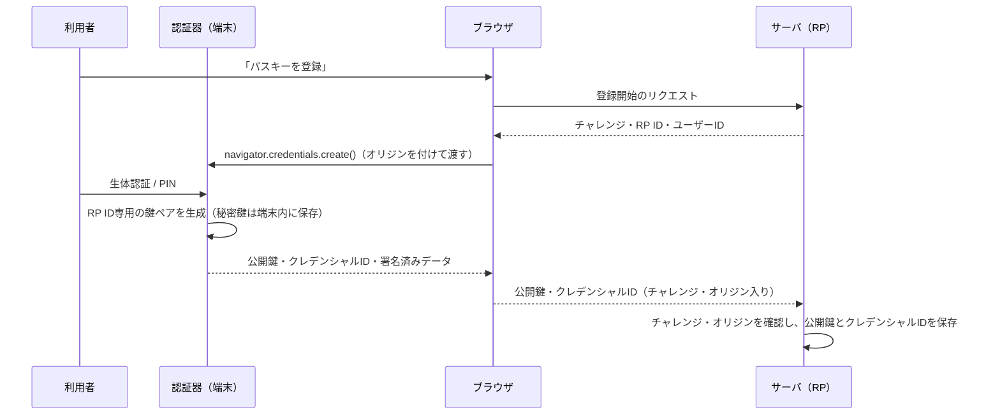
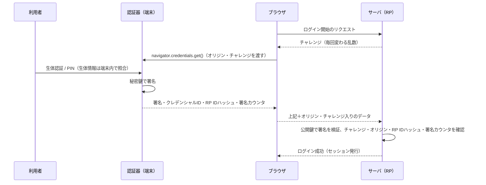

# 認証フローまとめ（リアルタイムフィッシング／WebAuthn／OAuth・PKCE／OIDC）

2026-11-12〜13 の雑談スレッドで整理した内容です。共通する考え方は1本だけです。

> **推測できない使い捨ての値を、あとで照合する。**
> WebAuthnのチャレンジ、OAuthの`state`、PKCEの`code_verifier`、CSRFトークン、OpenID Connectの`nonce`は、どれもこの仲間です。

---

## 1. リアルタイムフィッシング（MFAを突破する攻撃）

攻撃者は、利用者と正規サイトの間に罠サイトを挟んで中継します。

1. 利用者が、偽メールのリンクから罠サイトを開き、ID・PWを入力する
2. 攻撃者がそのID・PWを、すぐに正規サイトへ入力する
3. **正規サイトが、正規の利用者にOTPを送る**（SMSやメール）
4. 利用者は、届いたOTPを罠サイトに入力する
5. **攻撃者がそのOTPを正規サイトに入力し、認証される**（セッションを手に入れる）

- 採点のポイントは3と5です。「入力させる」で止めず、「コードが送られる」「攻撃者が認証される」まで書きます（2024h問2の失点）。
- 本質: **OTPは「どのサイトに入力するか」と結びついていない**ので、人間が罠サイトにも打ち込めてしまう。

---

## 2. WebAuthn（パスキー）

### 用語の関係
| 用語 | 正体 |
|---|---|
| WebAuthn | W3Cが定めた**ブラウザのAPI仕様**（`navigator.credentials.create` / `get`）。Webサイト（RP）とブラウザの間の取り決め |
| CTAP | ブラウザ（OS）と認証器（USBキー、スマホなど）の間の通信プロトコル。FIDO Allianceが策定 |
| FIDO2 | **WebAuthn ＋ CTAP** の総称 |
| パスキー | **同期できる discoverable credential**（ユーザー名を入れなくても端末が鍵を見つけられるクレデンシャル）の通称。iCloudキーチェーンやGoogleパスワードマネージャーなどで複数端末に同期される |
| RP ID | 鍵を結び付けるサイトの識別子（通常はドメイン名。例: `example.com`） |

### 登録フロー
1. 利用者がログイン済みの状態で「パスキーを登録」を押す
2. サーバが、**チャレンジ・RP ID・ユーザーID**（ランダムなハンドル。メールアドレスなどは避ける）を返す
3. ブラウザが `navigator.credentials.create()` を呼び、認証器が**そのRP ID専用の鍵ペア**を作る（生体認証やPINで本人確認）
4. 認証器が、**公開鍵とクレデンシャルID**をブラウザ経由でサーバへ返す（署名対象にはチャレンジとオリジンが入る）
5. サーバはチャレンジとオリジンを確認し、**公開鍵とクレデンシャルIDだけ**をユーザーに紐づけて保存する。秘密鍵は認証器から出ない

### 認証フロー
1. サーバが**チャレンジ**（毎回変わる乱数）を送る
2. ブラウザが `navigator.credentials.get()` を呼ぶ。**ブラウザ**が、署名対象のデータに「今アクセスしているオリジン」とチャレンジを書き込む
3. 利用者が生体認証やPINで認証器のロックを解除し、認証器が**秘密鍵で署名**して返す（RP IDのハッシュと署名カウンタも含まれる）
4. サーバが、登録済みの**公開鍵で署名を検証**し、あわせて次を確認する
   - **チャレンジ**が自分の発行した値か（リプレイ防止）
   - **オリジン**が自サイトか（フィッシング防止）
   - **RP IDハッシュ**が自サイトのものか
   - **署名カウンタ**が前回より増えているか（認証器の複製の検知）

### ログイン画面の段階移行（パスワードからパスキーへ）
1. **併用期**: これまでどおりパスワードでログインさせ、ログイン後に「パスキーを登録しませんか」と案内する
2. **Conditional UI**: ユーザー名欄に `autocomplete="username webauthn"` を付けると、入力欄をタップしたときにブラウザの自動入力候補としてパスキーが出る。パスワード欄とパスキーを同じ画面で共存できる
3. **パスキー優先**: 登録済みの利用者にはパスキーを優先して求める

- **弱点は回復手段**: 端末を紛失したときの回復（メール・SMSでのリセットなど）が弱いと、攻撃者はそこを狙う。パスワードやSMS認証を残す限り、全体の強さはそこまで下がる（下の「守れないもの」も参照）

### フィッシングに強い理由
- オリジンは利用者ではなくブラウザが書くので、ごまかせない。
- 罠サイト `examp1e.com` で作られた署名には `examp1e.com` と入っている。中継しても、正規サーバはオリジン不一致で拒否する。
- そもそも偽ドメインでは、認証器がそのサイト用の鍵を見つけられないことが多い。

**答案の型（R5秋問3）**: 「認証に用いる情報に含まれる**オリジン**及び**署名**をサーバが確認する仕組み」

### チャレンジ
- 中身: サーバが暗号論的に安全な乱数生成器で作るランダムなバイト列（16バイト以上推奨）。JSONで送るときにbase64urlにするので英数字に見える。
- 条件: **推測困難／一意・使い捨て／有効期限が短い**
- 固定値だと → 盗聴した過去の応答を再送するだけでなりすませる（リプレイ攻撃）。
- **答案の型**: 「チャレンジが毎回異なるので、盗聴した過去の応答を再送してもサーバの検証に失敗するから」（2024h問2「盗聴できたとしても」の観点）

### 試験の論点（答案に書く根拠）
| 論点 | 根拠となる仕組み |
|---|---|
| フィッシング耐性 | 署名対象に**オリジン**が入り、鍵が**RP ID**に結び付く → 罠サイトでは使えない／中継しても検証に失敗する |
| サーバから漏えいしても安全 | サーバにあるのは**公開鍵だけ** → 漏れてもなりすましに使えない（パスワードハッシュの漏えい・リスト型攻撃と対比） |
| リプレイ防止 | **チャレンジ**が毎回変わる → 過去の応答を再送しても通らない |
| 生体情報のプライバシー | 生体認証は**端末内**でのロック解除に使うだけ → 生体情報はサーバに送られない |
| 使い回し対策 | サイトごとに別の鍵ペア → 1サイトの漏えいが他サイトに波及しない |

### WebAuthnでも守れないもの
- ログイン後のセッションCookieを、マルウェアに盗まれる
- 「パスキーが使えない」と見せて、SMS認証などの弱い方法に誘導される（ダウングレード）
- アカウント復旧の手続きが弱い

→ 問題文に「代替手段としてSMSも残す」とあったら、ひっかけを疑う。

---

## 3. OAuth 2.0 認可コードフロー（＋PKCE）

### 登場人物（例: 写真印刷サービスが、利用者のクラウドストレージの写真を読む）

| 役割 | 例 |
|---|---|
| リソースオーナー | 利用者 |
| クライアント | 写真印刷サービス（**ブラウザではなく、連携する側のアプリ**） |
| 認可サーバ | ストレージのログイン・同意画面 |
| リソースサーバ | ストレージのAPI |

### 流れ
1. 利用者が、印刷サービスで「ストレージから写真を選ぶ」を押す
2. 印刷サービスが`state`と`code_verifier`を作ってセッションに保存し、ブラウザを認可サーバへリダイレクトする
   - URLに付けるもの: `client_id`、`redirect_uri`、`scope`、`state`、`code_challenge`（＝`code_verifier`のハッシュ）
3. 利用者が認可サーバでログインし、「写真の読み取りを許可しますか？」に同意する
4. 認可サーバが、ブラウザを`redirect_uri`へリダイレクトする（`?code=認可コード&state=…`）
5. 印刷サービスが、戻ってきた`state`とセッションの値を照合する
6. 印刷サービスが、**サーバ同士の通信で**、認可コードと`code_verifier`を認可サーバに送り、アクセストークンを受け取る
7. アクセストークンを付けてAPIを呼び、写真を取得する

### 押さえどころ
- 利用者のパスワードはクライアントに渡らない。渡るのは`scope`で絞った権限のトークン。
- 認可コードはブラウザのURL（フロントチャネル）を通るので漏れやすい → 短命・1回限り、交換はサーバ同士（バックチャネル）。

### どの対策が、どの段階を守るか

| 対策 | 照合する段階 | 防ぐ攻撃 |
|---|---|---|
| `state` | 手順2で保存 ↔ 手順5で照合 | CSRF（他人の認可コードを押し付けられる） |
| PKCE | 手順2の`code_challenge` ↔ 手順6の`code_verifier` | 認可コードの横取り（スマホのカスタムURLスキーム横取り、ログや履歴からの漏えい） |
| `redirect_uri`の完全一致 | 手順4 | 認可コードの送り先を攻撃者のURLにすり替える |

### `state`がないと起きるCSRF
1. 攻撃者が、**自分の**ストレージアカウントで手順1〜3を進め、手順4のURL（`?code=攻撃者のコード`）を手に入れて止める
2. そのURLを罠ページに仕込み、被害者に開かせる
3. 被害者の印刷サービスのアカウントが、**攻撃者のストレージ**に連携される
4. 被害者がアップロードした写真が、攻撃者のストレージに保存される

→ `state`があれば、被害者のセッションに保存された値と一致しないので弾ける。

### PKCE: なぜ先にハッシュ、後で元の値なのか
- ハッシュは一方向なので、手順2で`code_challenge`を見られても`code_verifier`は逆算できない。
- `code_verifier`が出てくるのは手順6が初めてで、TLSで守られた認可サーバとの通信だけ。終われば認可コードは使用済み。
- 逆だと、手順2で見えた`code_verifier`からハッシュを計算できてしまい、照合が成り立たない。
- `code_challenge_method=plain`（ハッシュしない）は手順2で漏れたら意味がない → **`S256`が原則**。問題文に`plain`があれば指摘ポイント。

**答案の型**
- 検証内容: 「検証コードのSHA-256ハッシュ値をbase64urlエンコードした値と、チャレンジコードの値との一致を確認する。」
- 防げる理由: 「認可コードを横取りしても、検証コードを知らない攻撃者はアクセストークンを取得できないから。」

---

## 4. OpenID Connect（OIDC）

- OAuthは**認可**（権限＝合鍵を渡す。アクセストークンには「誰か」も「誰宛てか」も書いていない）。
- OIDCは、OAuthの上に**認証**を足したもの。「誰がログインしたか」を証明する**IDトークン**を発行する。
- 呼び名: 認可サーバ → OpenIDプロバイダ（OP）、クライアント → RP（Relying Party）。

### OAuthとの違い（流れは3章とほぼ同じ）
1. 手順2で`scope`に`openid`を入れ、`nonce`も付ける
2. 手順6のトークン交換で、アクセストークンに加えて**IDトークン**が返る
3. RPはIDトークンを検証して、その利用者でログインさせる

### IDトークン（JWT）
- `ヘッダ.ペイロード.署名`をそれぞれbase64urlにしたもの。**署名であって暗号化ではない → 中身は誰でも読める。**
- 主な項目: `iss`（発行者）、`sub`（利用者の識別子）、`aud`（宛先＝RPの`client_id`）、`exp`（有効期限）、`nonce`

### RPが検証すべきこと
- 署名が正しいか（`alg=none`を受け付けない）
- `iss`が想定したOPか
- `aud`が**自分の**`client_id`か
- `exp`が切れていないか
- `nonce`が自分のセッションに保存した値と一致するか

### OAuthだけでログインすると危ない理由（トークン置換攻撃）
悪意のあるアプリAが、利用者からもらった**A宛ての**アクセストークンを別のアプリBに渡して「これでログインさせて」と言うと、Bは本人だと信じてしまう。IDトークンなら`aud`がAなので、Bは拒否できる。

### stateとnonceの違い

| 値 | 戻ってくる場所 | 確かめること |
|---|---|---|
| `state` | 手順4のURL | リダイレクトがCSRFでないか |
| `nonce` | IDトークンの中 | IDトークンが使い回し・差し替えでないか |

**答案の型（R6春問1）**: 「JWTに含まれる利用者IDがmidの値と一致するかどうかを検証する処理」＝「誰のトークンか」を照合する。

---

## 関連
- [頻出テーマ別_解答パターン.md](頻出テーマ別_解答パターン.md) の「2. 認証・認可」
- [頻出シチュエーション読解ドリル.md](頻出シチュエーション読解ドリル.md) の「SMSで届く確認コード」
